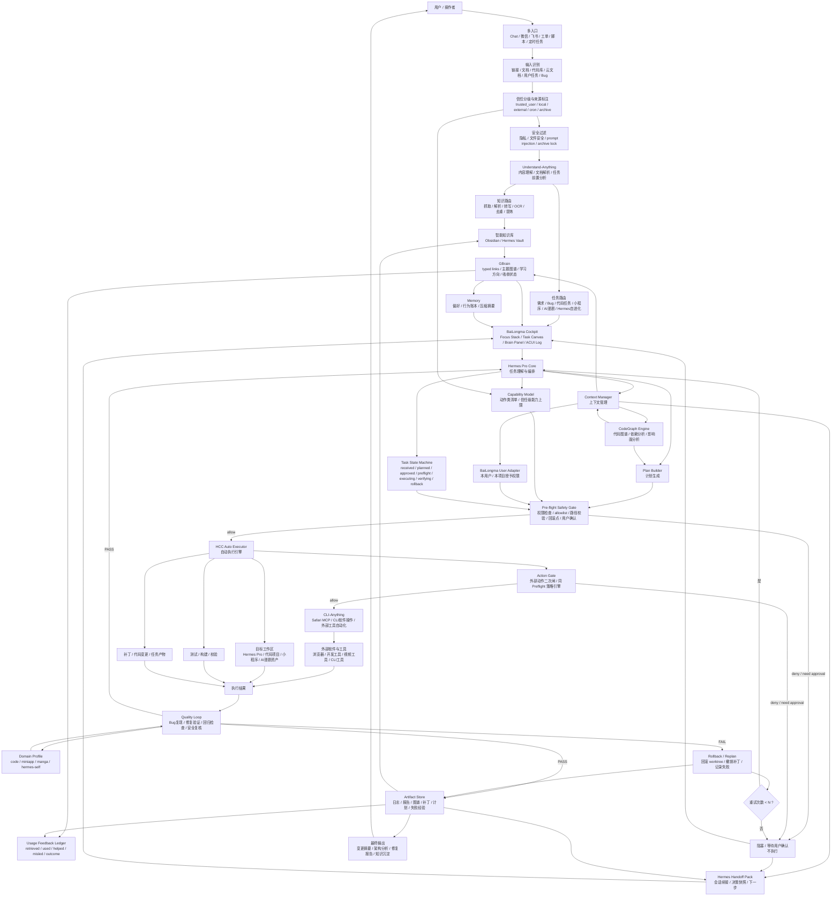

# Hermes Pro 当前融合计划（2026-05-30）

> 状态：当前执行参考，不替代锁定路线图。
> 最高约束：`~/.hermes/HERMES-SOUL.md` v5.3。
> 锁定路线图：`docs/roadmap-locked-2026-05-28.md`。
> 本文用途：把最新确认的架构、现状、下一步计划合并到一个不会漏模块的入口。
> 当前执行阶段：P3 dry-run baseline 001-006 + 008 + 009 + P3 harness 8 artifact + P3.5 upgrade candidate 软切换均已通过（2026-06-02）；**P3.5 soft switch 1-2 天观察期已结束、由用户裁决 KEEP v0.15.1（2026-06-04，ADR-20260604-p3-5-soft-switch-decision-keep-v0-15-1）、`hermes` 入口保持指向 candidate v0.15.1、rollback 备份仍可回滚**；**Knowledge Reuse Chain Slice 004-006.9 / 007A-007N / 008A-008M 已完成、6 commits 推送（2f79c75 / 2a8dc08 / cdeea86 / 7c3e89b / d997914 / d5a6469）、closeout base HEAD == origin/hermes-pro-main == d5a6469efd84ba98730c2fa3924e769019756077；当时工作区 clean；当时全量基线 81 files / 2931 tests PASS（npm run typecheck EXIT 0）**。**MODEL-STRATEGY 001-006B 已完成并推送至 origin（006B implementation commit `071b033596bfe07541b48c2aee86188d379d0475`；006B closeout：typecheck PASS，103 files / 3267 tests PASS；全链路 dry-run / read-only / design-only / no-live-config；真实 `~/.hermes/config.yaml`、handoff、audit 未触碰）**。P7 WeChat/iLink 4 个低优先级 cron job 已切 `deliver=local` 完成（2026-06-02）；BaiLongma Read-only Cockpit Final Polish 已 PASS（2026-06-02；typecheck + 46 files / 995 tests PASS — 该数字为 Final Polish 收口时点的局部事实源）。V5 保持 `MVP_PARTIAL`：C1/C2/C3 PASS，C4/C5 因生图/视频外部 API 不可控 + 成本不可控暂缓（非技术失败）。HCC Auto Executor 仍不可用、未启动、未接线；P3 真实执行仍暂停由 Hermes 直接执行，后续代码/项目任务由 Claude Code 按 dry-run 契约执行。Round 2 C 仍冻结；hard cutover 仍未批准；L6 live knowledge flush 未批准；BaiLongma/HCC Productionization NOT APPROVED。**Knowledge Reuse Chain 当前只到 L5 dry-run / prompt-builder，不代表 live knowledgeIngest / live knowledgeSearch / default system prompt injection / Agent subprocess / L6 live flush 已启用。**P0/P0.5/P1/P1.5/P2/P2.5/P3 dry-run 001-006 + 008 + 009 已通过，不应重复执行。P3 dry-run 基线事实源：`docs/p3-dry-run-baseline-2026-06-01.md`。

---

## 1. 核心需求

Hermes Pro 的核心需求是：

> 用户通过微信、飞书、Chat、定时任务、本地文件、外部链接等入口，把碎片知识和任务交给 Hermes；Hermes 在用户安全和电脑安全前提下，自动识别、过滤、解析、提炼、整理、吸收，并让这些知识能被智能体或用户检索使用，最终服务 Hermes Pro 系统能力提升、代码任务/小程序等项目开发、AI 漫剧制作。

这意味着 Hermes 不是单纯知识库，也不是单纯代码执行器，而是：

- **知识摄入与吸收系统**
- **任务理解与编排系统**
- **安全可控的自动执行系统**
- **面向真实产出的个人能力增强系统**

---

## 2. 本地实际情况

| 模块 | 本地事实 | 状态 |
|------|----------|------|
| Hermes Pro 项目 | `/Users/midoudou/hermes-pro` | ✅ 存在 |
| 灵魂文件 | `/Users/midoudou/.hermes/HERMES-SOUL.md` v5.3 | ✅ 已更新 |
| BaiLongma | `docs/bailongma/` + POC-2 + QA PASS | ✅ 只读 POC 完成，Productionization 未批准 |
| Knowledge UI | `knowledgeSearch` / `knowledgeIngest` / `getGbrainStats` | ✅ P0 PASS：固定查询 0 超时；过时计划目录硬排除已验证 |
| Vault API | `listVaultFiles` / `readVaultFile` / `getVaultStats` | ✅ 已接 |
| Understand-Anything | `understandAnything` IPC/API，A-lite 在 `playbook-runner.ts` | ✅ 已接入 |
| CLI-Anything / Safari MCP | `~/.hermes/venvs/cli-anything-safari-p0` + `safari-mcp` enabled | ✅ Safari MCP MVP PASS |
| CodeGraph | V6 诊断 nodes=2078, edges=3588, ready | ✅ 已验证 |
| HCC | 文档定义 + HCC Cockpit read-only | 🔄 主流程仍需产品决策 |
| GBrain typed links | `src/shared/lib/typed-links.ts` + `tests/typed-links.test.ts` | ✅ P1 PASS：只读 typed links、evidence/provenance/trust_level 已实现，25/25 tests PASS |
| Handoff / handoff-agent | `~/.hermes/handoff/packs/HANDOFF-P0.5-20260531-001.json` + verifier report | ✅ P0.5 PASS：Handoff Pack 已生成，脱敏扫描 0 发现，Verifier 7/7 通过 |
| Usage Feedback | `src/shared/lib/usage-feedback.ts` + `tests/usage-feedback.test.ts` | ✅ P1.5 PASS：append-only in-memory ledger 已实现，15/15 tests PASS，不改变检索排序 |
| Domain Profile | 领域化 Quality Loop 接口 | ⏳ P3 接口先定，代码 profile 先实现，AI 漫剧 P5 插件化接入 |
| P2.5 安全基座 | `docs/security/p2-5-safety-foundation-2026-05-30.md` | ✅ PASS：12/12 硬限制全满足；278/278 tests PASS；EXIT CODE 0 |
| WeChat/iLink | schedule staggering verified; low-priority 4 jobs `deliver=local` applied | ✅ **P7 local delivery applied**（4 个低优先级 cron job：`db41a513ebfd` / `21129f505fb4` / `28f0bff3083d` / `skill-cleanup-weekly`；schedule / prompt / skill set / enable state / state 全部不变；仅 `deliver: weixin → local`；高优先级投递策略仍待决策）。报告：`~/.hermes/pipeline-runs/HCC-20260602-P7-WECHAT-ILINK-LOCAL-DELIVERY/01-report.md` |
| MODEL-STRATEGY | `docs/model-strategy/hermes-model-strategy-2026-06-05.md` + shared helpers/tests | ✅ 001-006B PASS：implementation through `071b033`；latest baseline typecheck PASS + 103 files / 3267 tests PASS；dry-run/read-only/design-only；no live config writes；cloud providers remain user-configured; API keys/secrets are not echoed by docs/fixtures/descriptors |

---

## 2.1 当前阶段进度（2026-06-01）

| 阶段 | 状态 | 本地证据 |
|------|------|----------|
| P0：知识入口运行态修复 | ✅ PASS | `~/.hermes/hermes-agent/agent/knowledge_agent.py` 已增加硬排除；固定查询 5/5 成功；过时目录搜索 0 返回 |
| P0.5：Hermes Handoff Pack MVP | ✅ PASS | `~/.hermes/handoff/packs/HANDOFF-P0.5-20260531-001.json`；`VERIFIER-REPORT-P0.5-20260531-001.json` |
| P1：GBrain typed links MVP | ✅ PASS | `src/shared/lib/typed-links.ts`；`tests/typed-links.test.ts`；25/25 tests PASS |
| P1.5：Usage Feedback Ledger | ✅ PASS | `src/shared/lib/usage-feedback.ts`；`tests/usage-feedback.test.ts`；15/15 tests PASS |
| P2：BaiLongma 主驾驶舱升级 | ✅ PASS | typecheck PASS + tests 360 PASS + UI QA PASS；无写入；无 HCC/CLI/Safari MCP 外部动作 |
| P2.5：安全基座 | ✅ PASS | `src/shared/lib/safety/types.ts`；`src/main/safety/audit-log.ts`；`src/main/safety/preflight.ts`；`src/main/safety/action-gate.ts`；`src/main/safety/resource-lease.ts`；`src/main/safety/rollback-strategy.ts`；`src/main/safety/retry-runtime.ts`；`src/shared/lib/safety/redaction-scanner.ts`；`src/shared/lib/safety/builder-verifier.ts`；`src/shared/lib/safety/knowledge-trust.ts`；`src/shared/config/index-exclusions.ts`；12/12 硬限制全满足；278/278 tests PASS；EXIT CODE 0 |
| P3 dry-run 001：HCC dry-run planning skeleton | ✅ PASS | `src/main/hcc-task-runner.ts` / `hcc-task-types.ts` / `tests/safety/hcc-task-runner.test.ts` 46/46 |
| P3 dry-run 002：CodeGraph impact 接入 dry-run plan | ✅ PASS | `CodeGraphStatus` / `CodeGraphImpact` / `HCCCodeGraphContext`；+18 tests |
| P3 dry-run 003：Domain Profile: code | ✅ PASS | `src/shared/lib/safety/domain-profile.ts`；`tests/safety/domain-profile.test.ts` 13/13；runner +17 tests |
| P3 dry-run 004：HCC plan → VerifierInput | ✅ PASS | `buildHCCVerifierInput`；`tests/safety/hcc-verifier-input.test.ts` 26/26；391/391 总 |
| P3 dry-run 005：端到端 dry-run 契约 | ✅ PASS | `tests/safety/hcc-dry-run-contract.test.ts` 30/30；421/421 总 |
| P3 dry-run 006：Handoff Pack dry-run payload | ✅ PASS | `src/main/hcc-handoff-pack.ts`；`tests/safety/hcc-handoff-pack.test.ts` 30/30；450/450 总 |
| P3 dry-run 008：Handoff payload temp fixture + local verifier-only check | ✅ PASS | `write/read/verifyHCCHandoffPayloadFixture`；`tests/safety/hcc-handoff-fixture.test.ts` 20/20；`tests/safety` 当时 19 files, 470/470 PASS |
| P3 dry-run 009：Artifact Store dry-run record | ✅ PASS | `src/main/hcc-artifact-store.ts` new；`tests/safety/hcc-artifact-store.test.ts` new 45/45；`tests/safety` 20 files, 515/515 PASS；typecheck EXIT 0；record `dryRun:true` / `executable:false` / `runtime_class:"dry_run"` 类型硬编码；tmpDir 写读，零真实 `~/.hermes/handoff/packs` 与 `~/.hermes/audit` 写入。报告：`~/.hermes/pipeline-runs/HCC-20260601-P3-SLICE-009-artifact-store-dry-run/01-report.md` |
| P3 harness 跨模块链路测试（Chain Test 002） | ✅ PASS | `tests/safety/hcc-p3-exchange-contract.test.ts` 20/20；plan → handoff fixture → artifact record → fixture → verify 端到端 |
| P3 harness 真实小源码任务（Code Task 003-006） | ✅ PASS | `src/main/hcc-artifact-store.ts` + `src/main/hcc-handoff-page-summary.ts`；4 个新模块/函数；`tests/safety` 23 files, 625/625 PASS |
| P3 harness 文档同步（Doc-Sync 009） | ✅ PASS | 4 entry-point 文档 cross-checked |
| P3 harness 关闭 + Final Closeout | ✅ PASS | 8 artifact + 1 closeout + 1 final closeout |
| Knowledge Reuse Chain Slice 004-006.9（2026-06-04） | ✅ PASS | `docs/knowledge/knowledge-reuse-protocol-2026-06-02.md` 等 3 篇；`src/shared/lib/knowledge-reuse-protocol.ts` + `knowledge-reuse-integration.ts`；3 个 knowledge-reuse-* 测试；commit `2f79c75` docs + `2a8dc08` fixtures + `cdeea86` shared lib + `7c3e89b` tests 之一 |
| Knowledge Reuse Chain Slice 007A-007N（2026-06-04） | ✅ PASS | handoff contract + optional hcc handoff knowledge envelope；`src/shared/lib/knowledge-handoff-contract.ts` + `knowledge-agent-contract-snippet.ts`；`src/main/hcc-handoff-pack.ts` 增量 wire envelope；7 个测试 + safety 链测 |
| Knowledge Reuse Chain Slice 008A-008M（2026-06-04） | ✅ PASS | Surface B + task-dispatch prompt builder；`src/shared/lib/knowledge-runtime-injection-surface-b.ts` + 4 sibling lib；`src/main/task-dispatch-prompt-builder.ts`；8 个测试 + safety chain；commits `d997914` + `d5a6469` |
| 全量测试基线（2026-06-04） | ✅ 81 files / 2931 tests PASS | `npm run typecheck` EXIT 0；`npx vitest run` 全量；closeout base HEAD == `d5a6469efd84ba98730c2fa3924e769019756077` == `origin/hermes-pro-main`；当时工作区 clean。历史快照（46 files / 995 tests / 23 files / 625 tests / tests/safety 20 files / 515/515 等）保留作当时证据，不再代表当前全量。 |
| P3.5 upgrade candidate 完成（2026-06-02） | ✅ PASS + KEEP v0.15.1（2026-06-04 ADR） | Round 2 A/B-impl/B-smoke/B-fix + B-runtime-smoke + A-remain + hermes-candidate wrapper v1.2.0 + soft-to-live switch 排练 全部 PASS；soft switch 1-2 天观察期已结束、由用户裁决 KEEP v0.15.1（ADR-20260604-p3-5-soft-switch-decision-keep-v0-15-1）；当前 `hermes` 默认入口保持指向 candidate v0.15.1，rollback 备份保留在 `~/.hermes/backups/hermes-live-wrapper-pre-soft-switch-20260602/` |
| P7 WeChat/iLink 4 个低优先级 cron job deliver=local | ✅ PASS | 4 job（`db41a513ebfd` / `21129f505fb4` / `28f0bff3083d` / `skill-cleanup-weekly`）`deliver: weixin → local`；schedule / prompt / skill set / enable / state 不变；高优先级投递策略仍待独立决策。报告：`~/.hermes/pipeline-runs/HCC-20260602-P7-WECHAT-ILINK-LOCAL-DELIVERY/01-report.md` |
| BaiLongma Read-only Cockpit Final Polish | ✅ PASS | 阶段条 7→10 行；风险/阻塞面板 4→9 行（4 blockers + 5 warnings）；下一步行动 4→5 行；badge "P2 主驾驶舱" → "BaiLongma Read-only Cockpit · 只读 · 无新增 IPC · 无写入 · P3.5 soft switch 观察期"；`tests/bailongma-status-sync.test.ts` 3→10 tests；typecheck EXIT 0；`npx vitest run` 46 files / 995 tests PASS；未新增 IPC；未调用 `runPlaybook(` / `triggerCronJob(` / `sendMessage(` / `config.set(`。报告：`~/.hermes/pipeline-runs/HCC-20260602-BAILONGMA-READONLY-FINAL-POLISH/01-report.md` |
| V5 状态（2026-06-02 重申） | ⏸️ `MVP_PARTIAL` | C1/C2/C3 ✅；C4（生图 API）/ C5（视频自动生成）暂缓。**暂缓原因不是技术执行失败，而是生图/视频外部 API 不可控 + 成本不可控**：超出当前安全基座可拦截范围（prompt-injection / 重试放大 / 无 review 中间产物）。需新 ADR + API key 预算审批 + Dry-run 边界 + 用户显式批才能恢复。V5 不进入外部 API 实跑。 |
| P3 真实执行：HCC + CodeGraph + Quality Loop | ⏸️ **dry-run baseline + harness + P3.5 soft switch PASS / real execution paused** | HCC Auto Executor 仍不可用、未启动、未接线；Claude Code 按 dry-run 契约执行 P3 代码/项目任务；Hermes 负责需求整理、计划审查、知识检索、Handoff Pack、执行结果归档。基线事实源：`docs/p3-dry-run-baseline-2026-06-01.md` |
| MODEL-STRATEGY 001-006B（2026-06-06） | ✅ PASS / dry-run + design-only | 001 dry-run fixture；002A provider catalog；002B smoke matrix；002C disabled UI descriptor；003A read-only HccCockpit panel；004A rollout simulation；004B rollback preview；004C UI rollout status projection；005A EchoBird taxonomy；005B Hermes-native model-nexus design descriptor；005C install/recovery diagnostics descriptor；006A lane/provider requirements descriptor；006B live config adapter approval contract。Implementation commit `071b033`；typecheck PASS；103 files / 3267 tests PASS；`~/.hermes/config.yaml`、handoff、audit 未触碰。 |

不得重跑 P0/P0.5/P1/P1.5/P2/P2.5/P3 dry-run 001-006 + 008 + 009；不得重跑 P3 harness 8 artifact；不得重跑 P3.5 Round 1-2 A/B-impl/B-smoke/B-fix / B-runtime-smoke / A-remain / hermes-candidate wrapper v1.2.0 / soft-to-live switch 排练；不得重跑 Knowledge Reuse Chain Slice 004-006.9 / 007A-007N / 008A-008M（已 6 commits 推送）。除非用户明确要求复验。**P3.5 soft switch 1-2 天观察期已结束（2026-06-04，ADR-20260604-p3-5-soft-switch-decision-keep-v0-15-1）**；KEEP 期内不改 `~/.local/bin/hermes` symlink（除 rollback 外）、不跑长驻进程、不写真实 handoff/audit、不切 hard cutover、不改 locked roadmap。如需回滚：`ln -sf /Users/midoudou/.hermes/hermes-agent/venv/bin/hermes /Users/midoudou/.local/bin/hermes`。在 HCC Auto Executor 可用并经用户明确授权前，P3 代码/项目任务交给 Claude Code 按 dry-run 契约执行；Hermes 不得直接启动 HCC Auto Executor，不得注册真实执行 IPC，不得执行 CLI-Anything / Safari MCP 深度动作。**Knowledge Reuse Chain 当前只到 L5 dry-run / prompt-builder；不得声明 live knowledgeIngest / live knowledgeSearch / default system prompt injection / Agent subprocess / L6 live flush 已启用；L6 live knowledge flush 未批准**。真实执行入口（spawn/runPlaybook/真 verificationCommands/真 Artifact Store 写入）必须另批。

后续建议顺序（仍由 Claude Code 在 dry-run 边界内执行；每步均需用户批准）：
- **A**：观察期内仅做 read-only / 轻量使用 hermes 命令（避免 `serve` / `run` / `agent` / `delegate` / `update` / `config set|edit`）
- **B**：soft switch 1-2 天观察期已结束（2026-06-04 由用户裁决 KEEP v0.15.1，ADR-20260604-p3-5-soft-switch-decision-keep-v0-15-1）；当前进入 KEEP 期；后续如需升级为 hard cutover 仍需新 ADR + 用户明确批 + 30 天 dual-run + Action Gate
- **C**：Round 2 C 仍冻结；如需启用则需独立 ADR + 用户显式批 + Action Gate 部署
- **D**：010（受控 worktree dry-run）仍需单独批准，且仅在 HCC Auto Executor 解冻后才有意义。008 + 009 + hermes-candidate wrapper 已覆盖 Hermes ↔ Claude Code dry-run 状态交换的完整契约链。

Mano-P 已放入待定项目，不是当前计划、不是候选试点。检索到 Mano-P 相关内容时，只能报告其待定状态；除非用户重新明确授权并满足硬件/云端验证条件，否则不得展开实施方案。

---

## 3. 当前融合架构



---

## 4. 模块定位

| 模块 | 定位 | 不能混淆的边界 |
|------|------|----------------|
| Hermes Core | 内核，负责理解、编排、调用、验证 | 不是 UI |
| BaiLongma | 主驾驶舱 UI / 认知编排视图 | 不是知识库，不替代 Core |
| GBrain | 知识吸收与关系层 | 不是普通文件列表 |
| Knowledge/Vault | 证据与内容存储 | 不直接改变路线图 |
| Understand-Anything | 看懂输入的前置理解层 | 不替代 CodeGraph |
| CodeGraph | 代码结构与影响面分析 | 不负责普通文档理解 |
| HCC Auto Executor | Hermes 核心长期能力：隔离 worktree 中安全自动执行代码/项目任务 | 当前仅 dry-run 计划/验证/交接契约（`tests/safety` 19 files, 470/470 PASS）；真实执行器需补齐 worktree 隔离、spawn、真实 rollback、Quality Loop 集成。不应删，是 Hermes 自主执行能力的关键载体 |
| CLI-Anything / Safari MCP | 外部 CLI/浏览器/软件操作桥 | 不能绕过授权和安全过滤 |
| Handoff / handoff-agent | 长上下文续接层，把当前任务状态压缩成可验证交接包 | 不把原始聊天记录、密钥、隐私内容无脑注入下一 Agent |
| Usage Feedback Ledger | 记录知识是否真的帮上忙，形成 GBrain 有用性信号 | P1/P2 只 append，不在无数据时盲目重排 |
| Domain Profile | 领域化 Quality Loop 插件接口 | 代码/小程序/AI 漫剧不能共用同一套硬编码验收语义 |
| Capability Model | 动作类清单 + 信任级能力上限 | 不可信输入不能直接升权到执行器 |
| BaiLongma User Adapter | 本用户 / 本项目授予权限 | 必须进入 Pre-flight，不得悬空 |
| Pre-flight Safety Gate | 事前安全闸，在执行前检查权限、allowlist、路径、回滚点和用户确认 | 不能放到执行后的 Quality Loop 才做 |
| Action Gate | 外部动作级二次闸，和 Pre-flight 共用同一策略引擎 | CLI/浏览器/外部软件不能边复核边执行 |
| Quality Loop | 复现、测试、回归、安全复核 | 不能被“看起来完成”替代 |

### 4.1 状态与存储边界

| 存储 | 唯一职责 |
|------|----------|
| Memory | 跨任务长期偏好、行为账本、稳定画像 |
| Handoff Pack | 单任务续接，只保存当前任务状态和 artifact 引用 |
| Artifact Store | 唯一证据真相源，保存命令输出、日志、diff、报告、失败经验 |
| Knowledge/Vault | 知识内容和证据材料，不直接改变计划或权限 |
| Usage Feedback Ledger | append-only 记录知识使用、结果和误导信号，供未来检索重排 |

---

## 5. Handoff 核心吸收

Handoff / handoff-agent 进入 Hermes 的定位不是“又一个知识库”，而是**长上下文续接层**：
当 Agent 上下文过长、换模型、换工具、换新会话、或任务跨天时，用一个结构化交接包告诉新 Agent：
现在到底做到哪、为什么这么做、哪些已验证、哪些不能碰、接下来从哪里开始。

### 5.1 采用内容

Hermes 吸收 Handoff 的核心，不直接照搬全部会话注入：

- **结构化交接包**：目标、当前状态、关键决策、已修改文件、已运行命令、验证结果、阻塞点、下一步。
- **三层记忆分工**：
  - `PROJECT.md` / 项目稳定事实：目标、架构、硬约束，低频修改。
  - `CHANGELOG.md` / 已完成历史：append-only，记录完成切片和技术债。
  - `HANDOFF.md` / 当前切片：可覆盖，记录当前任务的验收标准、约束、起点。
- **Builder / Verifier 分离**：执行 Agent 负责完成切片；验证 Agent 用干净上下文读 diff、验收标准、交接包，给 PASS / FAIL。
- **会话转移能力**：handoff-agent 可作为候选 CLI，用于 Codex / Claude / OpenCode 等 Agent 之间转移上下文，但必须先做 dry-run 和隐私过滤。

### 5.2 Hermes Handoff Pack 最小字段

每次重要任务结束、上下文接近溢出、或切换 Agent 前，产出一份 Hermes Handoff Pack：

```yaml
schema_version: "1.0"
task_id: string
created_at: string
created_by: codex | claude | hermes | other
git_ref: string | null
goal: 当前用户目标
active_truth_sources:
  - 当前必须读取的计划/架构/灵魂文件
do_not_read:
  - 过时计划目录和已锁定归档
current_state:
  done:
    - 已完成事项
  in_progress:
    - 正在进行事项
  blocked:
    - 阻塞原因和下一步验证
open_questions:
  - 当前仍不确定的问题
assumptions:
  - 当前假设
dead_ends:
  - 已验证不可行的尝试
decisions:
  - decision: 已确认决策
    why: 为什么这样选
    evidence_ref: artifact 或文件路径
changed_files:
  - path: 文件路径
    reason: 修改原因
    content_hash: string | null
verification:
  - command: 可重跑命令
    exit_code: number
    artifact_ref: 完整输出位置
next_actions:
  - 下一 Agent 应该先做什么
safety:
  permission_boundary: 哪些动作需要用户授权
  redaction_status: pass | fail | not_run
  secrets_policy: 不记录密钥、不复制隐私原文、不无脑注入完整聊天
```

### 5.3 与现有架构的关系

- Handoff Pack 从 `Artifact Store`、`Task State Machine`、`GBrain` 和执行日志生成。
- BaiLongma Cockpit 读取 Handoff Pack，显示“当前做到哪 / 下一步 / 风险 / 验证状态”。
- Context Manager 在新会话启动时优先读取 Handoff Pack，再按需读取计划和代码，不从长聊天记录里盲找线索。
- Knowledge/Vault 可以保存 Handoff Pack，但它的职责是“续接任务”，不是替代知识吸收。
- 过时计划目录仍受 archive lock 约束，Handoff Pack 的 `do_not_read` 必须显式列出。
- Handoff Pack 只引用 Artifact Store，不复制大段证据原文；生成前必须通过密钥/PII/路径脱敏检查。

---

## 6. 重新梳理后的计划

### P0：知识入口运行态修复

目标：先修复当前窄问题：Knowledge search 运行态超时；同时验证过时计划目录是否被索引器硬排除。

当前已知：
- Gateway `/health` 正常。
- Knowledge search 曾出现超时。
- Obsidian 与 Hermes Vault 均有本地内容。

验收：
- `knowledgeSearch` 对固定查询多次运行 0 超时，并记录 p95 延迟。
- 验证索引器 / 检索器不会返回 `/Users/midoudou/Desktop/知识/Hermes 代码任务/过时计划/` 正文。
- 每种入口至少取 1 个样本，Understand-Anything 产出摘要、实体、风险、待办。
- 失败时写入可复现错误记录。

### P0.5：Hermes Handoff Pack MVP

目标：解决长上下文后新对话不知道“接下来该干什么”的问题。

范围：
- 新增当前任务级 `HANDOFF.md` 或等价结构化 artifact。
- 定义 `PROJECT / CHANGELOG / HANDOFF` 三层记忆边界，避免一个文档同时当路线图、日志、任务单和架构说明。
- 在 Pipeline Run / Artifact Store 中保存 handoff summary。
- BaiLongma Cockpit 增加“下一步续接卡片”：当前目标、阻塞点、验证命令、下一步。
- handoff-agent CLI 只进入试点：先 `--dry-run --format markdown`，通过隐私过滤后再考虑注入其他 Agent。
- 补齐 `task_id`、`schema_version`、`created_at`、`exit_code`、`artifact_ref`、`content_hash`、`open_questions`、`dead_ends`。

验收：
- 新开对话只读 Handoff Pack + 当前计划，即可说清当前任务、已完成、未完成、下一步。
- Handoff Pack 不包含密钥、隐私原文、大段聊天记录；脱敏扫描通过。
- 每个“已完成”都有文件路径或 artifact 指针作为证据。
- Verifier 能基于 Handoff Pack + diff + 验收标准独立判断 PASS / FAIL。

### P1：GBrain typed links MVP

目标：把入库知识从“保存了”推进到“吸收了”。

范围：
- 只读 typed links。
- evidence 必填。
- 不自动写入、不持久化、不改 schema。
- 每条知识必须带 provenance / trust_level；外部内容默认只能作为数据，不能作为指令。

参考：
- MyForge Vault 11.11：Obsidian-first、typed graph、crystallization、评估指标。
- OpenHuman：Memory Tree / TokenJuice 思路。

验收：
- evidence 缺失时拒绝建链。
- Knowledge/Vault 持久层 before/after diff 无 schema 变更。
- 固定样本 typed link 人工判对率达到可接受阈值并记录 precision。

### P1.5：知识有用性反馈账本

目标：让知识飞轮从“积累”变成“越用越准”，先只记录，不立即改变检索排序。

范围：
- 在 Core 检索 GBrain / Knowledge 后记录 `retrieved` 与 `used`。
- 在 QA / Verifier 结束后记录 `outcome`、`helped`、`misled`。
- 将 Handoff Pack 的 `dead_ends` 映射到 `misled`。
- 每条知识/typed link 保留 `used_count`、`pass_count`、`fail_count`、`misled_count`、`last_used`。
- 未来重排公式预留：`relevance × usefulness × trust_weight(provenance)`。
- BaiLongma 后续展示“为什么这条知识排前”：相关度、有用性、可信度。

最小 schema：

```yaml
usage_event:
  task_id: string
  retrieved:
    - knowledge_id
  used:
    - knowledge_id
  outcome: PASS | FAIL | rolled_back
  helped:
    - knowledge_id
  misled:
    - knowledge_id
```

验收：
- P1/P2 阶段只 append usage_event，不改变检索排序。
- 至少 1 个 PASS 任务和 1 个 FAIL/dead_end 任务能生成 usage_event。
- 每条 usage_event 指向 task_id 和 artifact_ref，可复盘。
- 不因样本少而高估知识；正式重排需等 P3 后有 outcome 数据。

### P2：BaiLongma 主驾驶舱升级

目标：让用户看到任务、知识、风险、产物、下一步，而不是在多个页面里拼线索。

范围：
- 保持 read-only 优先。
- 用已有 API：cron、gateway、events、vault、knowledge、understand、pipeline runs。
- UI 参考 BaiLongma + awesome-design-md 中 Linear/Raycast/Voltagent。
- 每个面板必须是真实数据或显式标记“未接线”，禁止静默 mock。
- 隐藏 view 的后台轮询必须暂停，避免看不见的请求继续跑。

### P2.5：安全基座

目标：在 P3/P4 前补齐权限/能力模型、任务状态机、回滚策略和事前安全闸。

硬前置：
- P2.5 未验收前，P3 HCC 自动执行和 P4 CLI-Anything 深度试点不得开工。

范围：
- 权限/能力模型：输入信任级别 + 动作能力等级。
- 任务状态机：received → classified → planned → awaiting_approval → preflight → executing → verifying → done/failed/rolled_back。
- Pre-flight Safety Gate：执行前检查权限、allowlist、路径、回滚点、用户确认。
- Action Gate：外部工具、浏览器、CLI、不可逆动作的二次闸，与 Pre-flight 共用同一策略引擎。
- Append-only Audit Log：记录 preflight/action_gate/capability_grant/state_transition/rollback/user_override，带 hash 链。
- Scheduler / Resource Lease：为 worktree、本地 LLM、限流通道提供最小队列和资源租约；交互任务优先于 cron。
- Builder / Verifier 分离：产出者不能是唯一验证者，至少用不同上下文验证 Handoff Pack / diff / 验收标准。
- 回滚策略：文件 patch、命令副作用、浏览器/外部工具操作分级处理。
- 重试上限：回滚后只有在 `retry_count < N` 时才允许重新规划，超限必须升级给用户。
- 重试不得自动扩权；相同失败签名连续出现时提前停止。
- 知识 provenance：来源、信任级、抓取时间、是否可作为指令。
- 索引器硬排除：过时计划目录、docs/archive、`*.before-*`、`.noindex` 目录。
- trust_level 设定 capability 上限：`untrusted_external` / `unattended_cron` 默认只读/抓取，不能请求写项目、执行命令、浏览器操作或发布。
- 脱敏扫描器在 P0.5 就必须存在；P2.5 扩展夹具和验证云端 fallback 路径。

参考：
- `docs/security/p2-5-safety-foundation-2026-05-30.md`

验收：
- 模拟一个来自外链的高权限执行请求，被 pre-flight 拦截。
- 模拟一个 cron 任务请求执行命令，被 capability 上限拒绝。
- 模拟一个 CLI 外部动作，必须经 Action Gate 放行后才到 CLI-Anything。
- 给定 task_id 可从 append-only audit log 还原每个动作为何放行/拦截；篡改中间条目会被 hash 链发现。
- worktree / 本地 LLM / 限流通道存在最小资源租约策略；cron 任务不能抢占交互任务。
- Builder 生成的 Handoff Pack 必须由独立上下文 Verifier 校验。
- 模拟一个小型 patch 失败并成功回滚，不覆盖用户已有改动。
- 模拟超过重试上限后进入 Blocked，而不是无限 replan。
- Handoff Pack 脱敏扫描可抓到植入的假密钥。
- 索引器实测不返回过时计划正文。

### P3：HCC + CodeGraph + Quality Loop 主任务闭环

目标：让代码任务、小程序、Hermes Pro 自进化任务能走文件式半自动闭环。

当前执行策略（2026-06-04 更新）：P3 dry-run baseline 001-006 + 008 + 009 + P3 harness 8 artifact + P3.5 soft switch 已 PASS；**1-2 天观察期已结束、由用户裁决 KEEP v0.15.1（ADR-20260604-p3-5-soft-switch-decision-keep-v0-15-1）**。HCC Auto Executor 仍不可用、未启动、未接线。后续代码/项目任务由 Claude Code 按 dry-run 契约执行（产 plan / verifier section / handoff payload / artifact record，不接真实执行入口）。Hermes 只负责需求整理、计划审查、知识检索、Handoff Pack、执行结果归档。**当前 `hermes` 入口保持指向 candidate v0.15.1**（KEEP 期）；6/6 read-only smoke 已过；rollback 命令就位（备份在 `~/.hermes/backups/hermes-live-wrapper-pre-soft-switch-20260602/`）。基线事实源：`docs/p3-dry-run-baseline-2026-06-01.md`；soft switch 观察期报告：`~/.hermes/pipeline-runs/HCC-20260602-HERMES-SOFT-SWITCH-OBSERVATION/01-baseline.md`；KEEP 决议 ADR：`docs/adr/ADR-20260604-p3-5-soft-switch-decision-keep-v0-15-1.md`。

范围：
- HCC 需求翻译、用户确认、双视角计划审查、隔离 worktree 执行、Codex 双审+测试、交付。
- CodeGraph 必须进入 Context Manager。
- 执行结果必须进 Artifact Store 和 Knowledge/Vault。
- P3 只能在 P2.5 PASS 后开工。
- CodeGraph 触发逻辑：Understand-Anything 识别到代码库、代码任务、文件影响面需求时，TaskRoute 必须请求 Context Manager 调用 CodeGraph。
- Quality Loop 必须按 Domain Profile 派发；P3 先实现 `code` profile，不把 QA 写死成只能服务代码。

Domain Profile 最小接口：

```yaml
domain_profile:
  name: code | miniapp | manga | hermes-self
  artifact_types:
    - string
  verifier:
    hard_checks:
      - string
    soft_checks:
      - string
    pass_criteria: string
  rollback: string
  cost_signals:
    - tokens
    - api_calls
    - render_time
```

验收：
- 一个参考代码任务端到端跑通，并且每一步状态流转进入任务状态机。
- pre-flight 能拦截一个安全检查不通过的计划动作。
- 故意注入失败变更后能回滚到干净态，失败经验进入 Artifact Store + Knowledge。
- 红队文档中的注入指令不能在无人确认下触发执行器。
- `code` Domain Profile 完成，Quality Loop 通过 profile 读取 hard_checks/pass_criteria，而不是硬编码。
- usage_event 能记录本次任务使用了哪些知识、结果是否 PASS、哪些知识 helped/misled。

### P4：CLI-Anything / Safari MCP 安全工具桥

目标：把外部浏览器、CLI 软件、视频/开发工具操作纳入 Hermes Executor，但必须走授权和 allowlist。

范围：
- Safari MCP 继续作为已验证 MVP。
- CLI-Anything 深度能力进入候选/试点。
- 与 GUI-VLA 的关系：CLI-Anything 管“有 CLI/可脚本化的软件”；UI-TARS/OpenAdapt 如需评估，作为独立候选试点并需用户授权；Mano-P 已放入待定项目，不推进。

### P5：AI 漫剧提效链路

目标：把知识库和执行系统服务到 AI 漫剧产出。

范围：
- 输入：视频/图文链接、行业案例、提示词、工具文档。
- 处理：Understand-Anything + Knowledge + GBrain。
- 执行：脚本、分镜、提示词、资产、视频任务队列。
- 参考：awesome-video-generation、AstraVideo-AI。
- 通过 `manga` Domain Profile 接入 Quality Loop，而不是复用代码测试语义。
- 漫剧 verifier 至少覆盖角色一致性、分镜连贯性、规格合规、安全合规；美学项走人工确认。
- 失败的 seed / 提示词 / 资产组合写入 dead_ends 和 usage_event，反哺 GBrain。

### P6：外部 Agent 能力采纳决策

目标：把外部项目能力放进候选池，不直接污染主线。

规则：
- OpenClaw：sandbox / allowlist / channel abstraction。
- OpenHuman：Memory Tree / TokenJuice / auto-fetch。
- Ruflo：worker taxonomy / trajectory learning。
- MiroFish：未来风险推演/仿真试点。**仅借鉴思路**（执行前风险推演、GraphRAG、ReportAgent），不可引用代码（专属许可证）。不设独立 Phase，不设时间线。当 HCC Auto Executor 需要 plan risk simulator 时，以此为参考做最小原型验证。
- EchoBird：模型中心 / 本地模型兜底 / 安装修复 / AI 应用管理的产品参考。**仅做产品模式审计与 Hermes 本地设计**，不复制 BUSL 代码、不采用私有 core、不接 runtime、不改模型 live config。当前已落到 `MODEL-STRATEGY-005A/005B/005C` 与 `MODEL-STRATEGY-006A`：模型中心 / 本地兜底 / 安装修复 / 用户自配 provider requirements 均为 design-only；本地模型下载、credential pool、keychain、live config adapter 仍需未来显式批准。
- DataLogicEngine：Trace Viewer / audit / explainable reasoning。
- 全部必须 ADR + 用户确认后才能进入锁定主线。

---

## 7. 过时文档处理规则

不直接删除、不直接移动。候选文件先进入 `docs/deprecation-candidates-2026-05-28.md`，由用户决定是否移动到：

`/Users/midoudou/Desktop/知识/Hermes 代码任务/过时计划/`

移动前必须保留：
- 原路径
- 为什么过时
- 被哪个新入口替代
- 是否仍有历史参考价值
