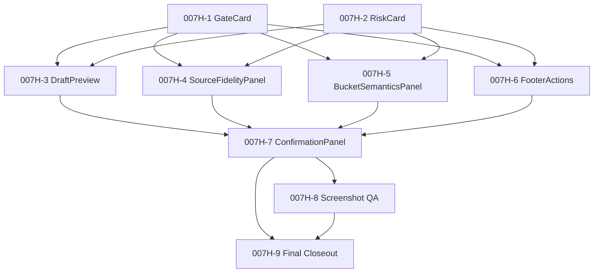

# Hermes Pro — Knowledge Live Flush Renderer Implementation Slice Plan (2026-06-03)

> Slice 007H — Renderer Implementation Slice Plan / No Code
> 范围: plan doc + tests + planning fixture JSON; 不实现 React 组件, 不写 .tsx, 不接 IPC, 不改 preload, 不启 dev server, 不跑 Playwright。
> 上游: 004-007G (helper / contract / dry-run / fidelity / bucket / 007A design / 007B pure helper / 007C UI design / 007D copy deck / 007E renderer plan / 007F fixture acceptance / 007G readiness review)
> 下游: 真实 007H-1 ~ 007H-9 (需用户**新批**, 仍 no impl) / 008A (real adapter design, 另批) / 008 (real live adapter, 另批)

## 1. Purpose

把未来 renderer UI 实装拆成可执行的**分 slice / 分 PR 计划**。

- 9 个 future implementation slice (007H-1 ~ 007H-9)
- 每个 slice 定义: goal / allowed files / disallowed files / required tests / fixtures / acceptance / forbidden copy / no-runtime / rollback / merge prereq
- 明确依赖图与合并顺序
- 明确 stop conditions (任一违例 → 停)
- 明确 files allowed (克制: 仅未来 component + test + Knowledge.tsx 007H-7 单点 tab 增)
- 明确 PR gate / merge order / final readiness

**输出**: 计划文档 + planning fixture JSON + tests。
**决策**: **GO for renderer implementation planning only** — 仍不是 GO for 实际实现。

## 2. Non-goals (本 slice 明确不做)

- ❌ 不实现任何 React 组件 / `.tsx` 文件
- ❌ 不新增任何 `.tsx` 文件
- ❌ 不改 `src/renderer/src/**` 任何文件
- ❌ 不改 `src/preload/index.ts` / `src/preload/index.d.ts`
- ❌ 不改 `src/main/**`
- ❌ 不改 `src/shared/lib/knowledge-live-flush-ui-contract.ts` (read-only consumption)
- ❌ 不改 `src/shared/lib/knowledge-live-flush-contract.ts` / `knowledge-reuse-protocol.ts` / `knowledge-reuse-integration.ts`
- ❌ 不改 `package.json` / `electron.vite.config.ts`
- ❌ 不改 `.env*` / `src/shared/i18n/**` / `src/shared/contracts/**`
- ❌ 不接 `window.hermesAPI.knowledgeIngest(`
- ❌ 不接 `runPlaybook` / `triggerCronJob` / `sendMessage`
- ❌ 不启动 HCC / hard cutover / Round 2 C
- ❌ 不改 locked roadmap (`docs/roadmap-locked-2026-05-28.md`)
- ❌ 不写真实 `~/.hermes/handoff/packs` / `~/.hermes/audit`
- ❌ 不触发 cron / WeChat / iLink
- ❌ 不实现真实 live adapter
- ❌ 不在 Hermes Knowledge / Vault / 任何文件真实写入
- ❌ 不启 dev server / 不跑 Playwright / 不采集截屏
- ❌ 不实装 i18n 资源 / a11y / keyboard

## 3. Preconditions

未来实装前必满足:

| # | 前置条件 | 来源 | 状态 |
|---|---------|------|------|
| 1 | 007G readiness review PASS | Slice 007G | ✅ done |
| 2 | 4 上游 slice (007C/007D/007E/007F) 全部 ready | Slice 007G § 3 | ✅ done |
| 3 | 12 helper pure API 全部 ready | Slice 007G § 5 | ✅ done |
| 4 | 3 fixture + 3 spec fixture 全部 ready | Slice 007G § 6 | ✅ done |
| 5 | 7 组件 × 4-5 acceptance bullets matrix ready | Slice 007F | ✅ done |
| 6 | 30 forbidden phrase 清单 ready | Slice 007D | ✅ done |
| 7 | 7 类 gate (PR / Test / Forbidden copy / a11y / Keyboard / Screenshot / Runtime safety) 全部定义 | Slice 007G § 8-14 | ✅ done |
| 8 | 用户**显式批** 007H-1 (首个 implementation slice) | (本 slice 不批) | ⏳ pending |
| 9 | (后续 slice) 用户显式批每个 PR | (本 slice 不批) | ⏳ pending |

## 4. Slice overview (9 future slices)

| Slice | 名称 | 类型 | 目标 |
|-------|------|------|------|
| **007H-1** | GateCard implementation | leaf | 单张 gate card (×5) |
| **007H-2** | RiskCard implementation | leaf | 单张 risk card (×6) |
| **007H-3** | DraftPreview implementation | composed | title+summary+findings+provenance |
| **007H-4** | SourceFidelityPanel implementation | composed | 3 list + verbatim source_uri/fetched_at |
| **007H-5** | BucketSemanticsPanel implementation | composed | 3 bucket 段 + per-check badge |
| **007H-6** | FooterActions implementation | interactive | phrase + risks + Confirm/Reject/Close |
| **007H-7** | ConfirmationPanel composition | top-level | useReducer + 组合前 6 |
| **007H-8** | Screenshot QA slice | QA (deferred) | 3 截屏采集 (dev server 后) |
| **007H-9** | Final renderer closeout | closeout | final test pyramid + final closeout doc |

007H-8 / 007H-9 留待 007H-7 合并 + 用户**新批**后启动。

## 5. Slice dependency graph



依赖:

- `007H-1`: 无依赖
- `007H-2`: 无依赖
- `007H-3`: `[007H-1, 007H-2]`
- `007H-4`: `[007H-1, 007H-2]`
- `007H-5`: `[007H-1, 007H-2]`
- `007H-6`: `[007H-1, 007H-2]`
- `007H-7`: `[007H-1, 007H-2, 007H-3, 007H-4, 007H-5, 007H-6]`
- `007H-8`: `[007H-7]` (deferred)
- `007H-9`: `[007H-7, 007H-8]`

## 6. Per-slice implementation plan (9 slice, 统一 schema)

### 6.1 Slice schema

每个 slice 必含 10 字段:

| 字段 | 描述 |
|------|------|
| Goal | 1-2 句目标 |
| Allowed files | 允许新增/修改的文件路径白名单 |
| Disallowed files | 显式禁改的路径 (defence in depth) |
| Required tests | 必跑测试 (component / fixture / scanner) |
| Required fixtures | 必消费 3 fixture |
| Acceptance criteria | 5 项可重跑断言 |
| Forbidden copy assertions | 必扫的 30 forbidden phrase |
| No-runtime assertions | IPC / fetch / runtime 必为 0 |
| Rollback point | `git revert` 安全点 |
| Merge prerequisite | PR gate 7 项 (typecheck / vitest / rg / 等) |

### 6.2 007H-1 GateCard implementation

- **Goal**: 单张 gate card (×5), 3 状态 (pass/warn/fail), 无 internal state, 无 prop mutation
- **Allowed files**: `src/renderer/src/components/Flush/KnowledgeFlushGateCard.tsx` + `.test.tsx` + 可选 `.module.css`
- **Disallowed**: `src/preload/**` / `src/main/**` / `src/shared/lib/knowledge-live-flush-ui-contract.ts` (read-only) / `package.json` / `electron.vite.config.ts` / `src/renderer/src/screens/Knowledge/Knowledge.tsx`
- **Required tests**: 5 gate types × 3 status snapshot / fail → aria-live=assertive / pass/warn → role=status, aria-live=polite / 3 fixture mount + scanner ok
- **Acceptance**: 5 gates distinct / 3 status visual distinct / fail propagation / scanner ok / no runtime
- **Rollback**: `git revert 007H-1` 安全
- **Merge prereq**: 7 项 PR gate

### 6.3 007H-2 RiskCard implementation

- **Goal**: 单张 risk card (×6), severity badge
- **Allowed files**: `KnowledgeFlushRiskCard.tsx` + `.test.tsx`
- **Required tests**: 6 categories snapshot / severity badge / scanner ok
- **Acceptance**: 6 distinct / live_flush_pending_hardening 恒 info / block severity 触发 acked affordance
- **Rollback**: `git revert 007H-2`

### 6.4 007H-3 DraftPreview implementation

- **Goal**: 渲染 title / summary / findings / provenance / trust_level / keywords (调 `projectRequestToSummary`)
- **Required tests**: 3 fixture mount / stale_sources 必显 / scanner ok
- **Acceptance**: 5 字段全显 / 3 段 list / provenance block / scanner ok

### 6.5 007H-4 SourceFidelityPanel implementation

- **Goal**: 3 list, exact source_uri / fetched_at preservation
- **Required tests**: verbatim source_uri / verbatim fetched_at / vault only vault:// / scanner ok
- **Acceptance**: 4 项 (verbatim × 2 / vault only vault:// / HARD FAIL blocks)

### 6.6 007H-5 BucketSemanticsPanel implementation

- **Goal**: 3 bucket 段, per-check status badge
- **Required tests**: 3 sections / local_plan in newly_found highlight / do_not_use_as_current_truth highlight
- **Acceptance**: 3 sections / misplacement visible

### 6.7 007H-6 FooterActions implementation

- **Goal**: phrase input + risks checkbox + Confirm/Reject/Close + 调 `computeConfirmButtonEnabled` + dispatch
- **Required tests**: 3-gate enablement / 3 disabled_reason / Reject/Cancel 永远在 / Copy draft json non-mutating / aria-required
- **Acceptance**: 4 项 (3-gate / reason visible / Reject always / Copy non-mutate)
- **No-runtime**: approve 仅 dispatch reducer, 不发 IPC

### 6.8 007H-7 ConfirmationPanel composition

- **Goal**: top-level useReducer + 3 步向导 + 组合前 6
- **Allowed files**: `KnowledgeFlushConfirmationPanel.tsx` + `.test.tsx` + `src/renderer/src/screens/Knowledge/Knowledge.tsx` (仅增 `knowledgeFlushConfirm` tab, **无其他改动 / 无 IPC 接线**)
- **Required tests**: 3-step nav / open → state / approve (enabled) → onCapturedPending / approve (disabled) → no-op / close → reset / reject with/without / 20-step tab / 9 key / focus trap
- **Acceptance**: 3-step / state badge / safety footer / approve 仅 state / approved phase label / no IPC
- **Rollback**: `git revert 007H-7` + 还原 Knowledge.tsx tab

### 6.9 007H-8 Screenshot QA slice (deferred)

- **Goal**: 3 截屏采集 (`.wolf/designqc-captures/`)
- **Pre-prereq**: dev server 用户显式批 + 007H-7 merged
- **Acceptance**: 3 png + 视觉匹配 + scanner over captured text ok
- **Rollback**: 删 3 png + 还原 dev server 批

### 6.10 007H-9 Final renderer closeout (deferred)

- **Goal**: final test pyramid + final fixture inventory + final forbidden copy gate
- **Pre-prereq**: 007H-7 + 007H-8 merged
- **Acceptance**: 7 组件 tests + 3 fixture mounts + 15 no-runtime criteria 全过

## 7. Files allowed per slice (克制原则)

### 7.1 Global allowed (跨 slice, 白名单)

- `src/renderer/src/components/Flush/KnowledgeFlush*.tsx` (7 组件)
- `src/renderer/src/components/Flush/KnowledgeFlush*.test.tsx` (7 测试)
- `src/renderer/src/components/Flush/*.module.css` (可选)
- `src/renderer/src/screens/Knowledge/Knowledge.tsx` (仅 007H-7, 加 `knowledgeFlushConfirm` tab)

### 7.2 Global disallowed (黑名单, 任一 slice 禁改)

- `src/preload/**`
- `src/main/**`
- `src/shared/lib/knowledge-live-flush-ui-contract.ts` (read-only consumption)
- `src/shared/lib/knowledge-live-flush-contract.ts`
- `src/shared/lib/knowledge-reuse-protocol.ts`
- `src/shared/lib/knowledge-reuse-integration.ts`
- `package.json` (无 dependency 改)
- `electron.vite.config.ts` (无 build config 改)
- `.env*` (无 secret / config 改)
- `src/shared/i18n/**` (read-only)
- `src/shared/contracts/**` (read-only)

### 7.3 共享 helper 防御 (renderer slice 不得改)

未来若任一 component test 发现 helper 缺口, 必须:

- 停 PR
- 提 separate ADR + 单独 slice
- 用户显式批

**不允许** 在 007H-1 ~ 007H-7 任一 PR 修改 `knowledge-live-flush-ui-contract.ts`。

## 8. Tests per slice (统一 7 项)

每个 slice 必跑 7 项 gate:

1. **unit/component tests** — `tests/renderer/.../KnowledgeFlush*.test.tsx`
2. **fixture-based tests** — 3 fixture mount + snapshot
3. **forbidden copy scanner** — `scanForbiddenFlushUiCopy` over rendered text
4. **no IPC/preload diff assertion** — `rg src/renderer 0 IPC tokens` + `git diff src/preload` 0 行
5. **runtime forbidden token rg** — `rg src/renderer` 0 `knowledgeIngest` / `knowledgeSearch` / `fetch` / `ipcMain` / `ipcRenderer` 等
6. **typecheck** — `npm run typecheck` EXIT 0
7. **git diff --check** — clean

外加全 suite (`npx vitest run`) 无回归。

## 9. Acceptance criteria per slice

每 slice 5-10 项 acceptance criteria (见 § 6)。任一违例 → 拒绝 merge + 触发 stop condition。

## 10. Forbidden actions per slice (10 项)

任一 slice 触发任一项即停:

1. 写 `window.hermesAPI.*` 调用
2. 写 `fetch(` / `axios` / `XMLHttpRequest`
3. 写 `knowledgeIngest` / `knowledgeSearch` / `gateway` / `serve` / `run` / `agent` / `delegate` / `playbook` token
4. 写 "已保存" / "写入成功" / "saved successfully" / "will be written after confirm" 短语
5. 写 "Obsidian Vault path" / "MEMORY.md" / ".wolf/cerebrum" 短语
6. 改 `src/preload/**` (除 007H-7 tab addition 外)
7. 改 `src/shared/lib/knowledge-live-flush-ui-contract.ts`
8. 改 `package.json` / `electron.vite.config.ts`
9. 改 `.env*` / `src/shared/i18n/**` / `src/shared/contracts/**`
10. 改 locked roadmap 或任何 HCC / cron / handoff / audit 路径

## 11. Rollback plan (per slice)

每个 slice 的 rollback point 必为 `git revert <PR>` 安全:

- 007H-1 ~ 007H-6: 单 PR revert, 无 shared helper 改动, 无 preload 改动, 安全
- 007H-7: PR revert + 还原 `Knowledge.tsx` `knowledgeFlushConfirm` tab 添加
- 007H-8: 删 3 png + 还原 dev server 批
- 007H-9: n/a (closeout-only)

回滚后所有 gate 必仍 PASS, 0 回归。

## 12. PR gate (per slice, 7 项)

1. no IPC / preload diff (除 007H-7 tab addition)
2. no knowledgeIngest / gateway / runtime call
3. no forbidden copy
4. fixtures render clean
5. typecheck EXIT 0
6. vitest full suite PASS
7. git diff --check clean

任一失败 → 拒绝 merge。

## 13. Merge order (9 slice 严格顺序)

```
1. 007H-1 (GateCard)
2. 007H-2 (RiskCard)
3. 007H-3 (DraftPreview)         [需 1+2 merged]
4. 007H-4 (SourceFidelityPanel)  [需 1+2 merged]
5. 007H-5 (BucketSemanticsPanel) [需 1+2 merged]
6. 007H-6 (FooterActions)        [需 1+2 merged]
7. 007H-7 (ConfirmationPanel)    [需 1+2+3+4+5+6 merged]
8. 007H-8 (Screenshot QA)         [需 7 merged, deferred]
9. 007H-9 (Final closeout)        [需 7+8 merged, deferred]
```

3-6 可平行 (在 1+2 完成后); 7-9 严格串行。

## 14. Stop conditions (10 项)

任一违例 → 立即停, 复盘:

1. **any IPC / preload diff** (除 007H-7 tab addition)
2. **any knowledgeIngest / gateway / runtime call** (`knowledgeIngest` / `knowledgeSearch` / `runPlaybook` / `sendMessage` / `triggerCronJob` / `fetch` / `axios` / `XMLHttpRequest`)
3. **any "saved / written / will write" promise copy** (含 zh/en 双语)
4. **any Obsidian / MEMORY / .wolf path recommendation**
5. **any HCC / cron / handoff / audit touch** (defensive guard)
6. **any screenshot mismatch** in 007H-8 QA slice
7. **any source fidelity or bucket semantics regression** (Slice 006.8 / 006.9 helpers)
8. **any typecheck / vitest / git diff --check failure**
9. **any forbidden token rg hit** on renderer src
10. **any shared helper modification** by renderer slice (需 separate ADR + 单独 slice)

## 15. Future runtime boundary (boundary spec)

未来 renderer 实装完成后, **runtime 边界** 仍如下:

```
[ Hermes Pro renderer ]
  ↓ (props: LiveFlushRequest)
[ reduceConfirmation + 007C 投影 ]  ← 本 slice 不动
  ↓ (state changes only)
[ 007H-7 ConfirmationPanel onCapturedPending ]
  ↓
[ parent component (留 008 决策) ]
  ↓
[ IPC layer (留 008 实装, 未批准) ]
  ↓
[ knowledgeIngest runtime (永不直接) ]
```

**renderer 永不发 IPC**; IPC 永远在 008 slice 显式批后才实装。`approved` ≠ `已写入`, UI 文案必含 "Pending live flush adapter approval"。

## 16. Final readiness criteria (15 项, 全 007F § 12)

未来 007H-9 closeout 时必满足 15 项 acceptance criteria (沿用 007F § 12):

1. `src/renderer/src/screens/Knowledge/KnowledgeFlush*` 0 处 `window.hermesAPI.knowledgeIngest(`
2. 0 处 `knowledgeSearch(`
3. 0 处 `runPlaybook(` / `sendMessage(` / `triggerCronJob(`
4. 0 处 `gateway*(`
5. 0 处 `fetch(` / `axios` / `XMLHttpRequest`
6. 0 处 "已保存" / "写入成功" / "确认后将写入" / "saved successfully" / "will be written after confirm"
7. 0 处 "Obsidian Vault path" / "MEMORY.md" / ".wolf/cerebrum" / ".wolf/anatomy"
8. 7 个未来组件全部存在, 文件名严格按 § 4 命名
9. `npx vitest run tests/renderer/KnowledgeFlush*` 全部 PASS
10. `npx vitest run` 全 suite 无回归
11. `npm run typecheck` 双端 EXIT 0
12. `git diff --check` clean
13. `rg -n "knowledgeIngest\(|knowledgeSearch\(|fetch\(|ipcMain|ipcRenderer|triggerCronJob|sendMessage|runPlaybook|child_process|delegate_task|serve|agent" src/renderer/src/screens/Knowledge/KnowledgeFlush* src/renderer/src/components/KnowledgeFlush*` 0 命中
14. Playwright 截屏采集 3 fixture, 入 `.wolf/designqc-captures/`
15. `forbidden_phrase_scan` 在所有 3 fixture 跑通, `ok=true`

任一失败 → 拒绝 closeout。

### 16.1 NOT-GO 决策 (显式英文 + 中文, 不可绕过)

本 slice (007H) 是 GO for renderer implementation planning only。显式 NOT-GO:

- NOT-GO for actual implementation in this slice (本 slice 仅规划, 仍 no impl)
- NOT-GO for runtime (Slice 008 not approved; no live knowledgeIngest call)
- NOT-GO for live adapter (Slice 008 still not approved)
- NOT-GO for IPC / preload (no window.hermesAPI call, no src/preload/** changes)
- NOT-GO for real write (no Hermes Knowledge / Vault / any file write)

## 17. 链路索引

- 协议: `src/shared/lib/knowledge-reuse-protocol.ts` (Slice 004)
- 契约: `docs/knowledge/knowledge-agent-prompt-contract-2026-06-02.md` (Slice 005)
- 集成: `src/shared/lib/knowledge-reuse-integration.ts` (Slice 006)
- 样例: `tests/fixtures/knowledge-reuse/github-research-save-dry-run.json` (Slice 006.5)
- 速查: `docs/knowledge/knowledge-agent-quick-reference-2026-06-03.md` (Slice 006.6)
- 评估: `docs/knowledge/knowledge-tri-agent-dry-run-evaluation-pack-2026-06-03.md` (Slice 006.7)
- fidelity: `validateKnowledgeSourceFidelity` (Slice 006.8)
- bucket: `BucketSemanticsResult` (Slice 006.9)
- 007A design: `docs/knowledge/knowledge-live-flush-adapter-design-2026-06-03.md` + `src/shared/lib/knowledge-live-flush-contract.ts`
- 007B pure helper: `docs/knowledge/knowledge-live-flush-contract-helper-2026-06-03.md`
- 007C UI design: `docs/knowledge/knowledge-live-flush-ui-confirmation-design-2026-06-03.md` + `src/shared/lib/knowledge-live-flush-ui-contract.ts`
- 007D copy deck: `docs/knowledge/knowledge-live-flush-ui-copy-deck-2026-06-03.md` + 3 fixtures
- 007E renderer plan: `docs/knowledge/knowledge-live-flush-renderer-implementation-plan-2026-06-03.md`
- 007F fixture acceptance: `docs/knowledge/knowledge-live-flush-renderer-fixture-acceptance-spec-2026-06-03.md` + 3 spec fixture
- 007G readiness review: `docs/knowledge/knowledge-live-flush-renderer-readiness-review-2026-06-03.md` + readiness-review.json
- **007H (本 slice)**: 本 doc + `tests/fixtures/knowledge-reuse/ui-render-acceptance/renderer-slice-plan.json`
- **007H-1 ~ 007H-9 (待用户新批)**: 9 个 implementation slice
- 008A (待批): real adapter implementation design (无 runtime)
- 008 (待批): real live adapter (IPC + audit + Handoff Pack)
- 009 (待批): post-implementation hardening

## 18. 继续冻结 (任一未来 slice 也不得触碰, 除非用户在新批)

- Round 2 C
- hard cutover
- HCC Auto Executor 启动
- WeChat / iLink 实际投递
- cron 实际执行
- locked roadmap (`docs/roadmap-locked-2026-05-28.md`)
- Hermes Agent default system prompt 改写
- Claude Code `CLAUDE.md` 契约改写
- Codex `AGENTS.md` 契约改写
- 真实 renderer 组件实装 (除 007H-1 ~ 007H-9 任一用户新批后)
- 真实 live adapter
- 真实 `~/.hermes/handoff/packs` / `~/.hermes/audit` 写入
- 启 dev server / 跑 Playwright / 采集截屏 (除 007H-8 用户新批后)
