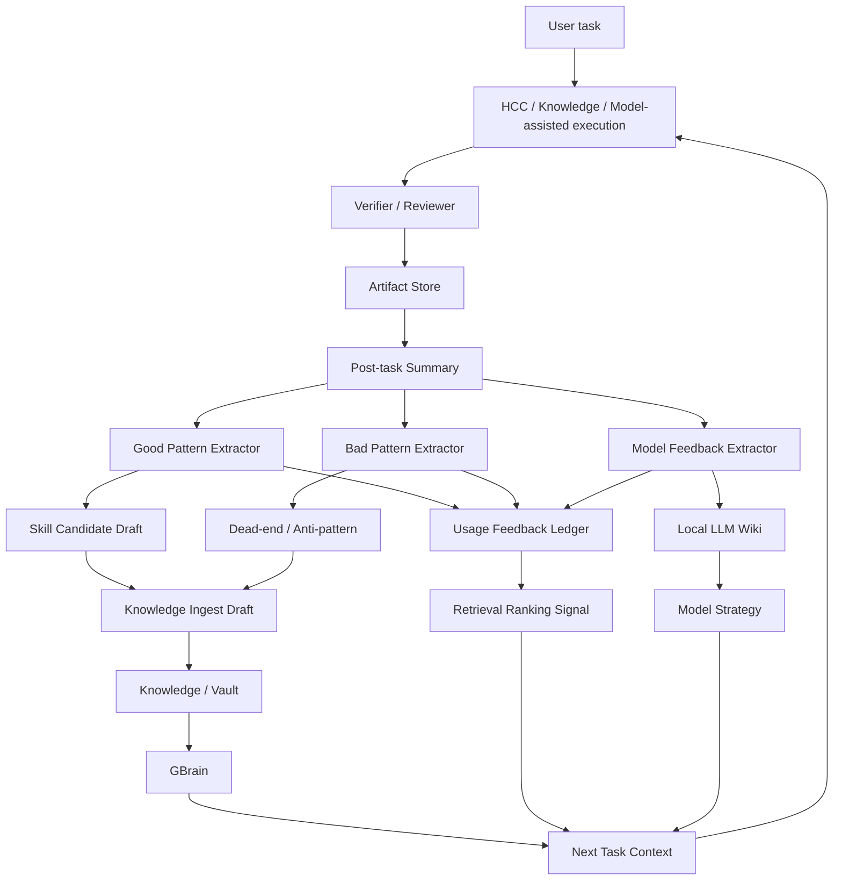

# Hermes Post-task Learning Loop Plan

Date: 2026-06-07
Status: planned, no runtime

## 1. Decision

The Hermes Pro product architecture must include a closed post-task learning loop.

The loop is:

```text
task result
-> post-task summary
-> good pattern / bad pattern extraction
-> skill candidate / dead-end / model feedback
-> knowledge ingest draft
-> GBrain / usage feedback / local LLM wiki
-> next task context
```

This is not a replacement for HCC. It is the feedback layer that makes HCC, Knowledge, GBrain, Model Strategy, and Skills improve after each task.

## 2. Current State

Hermes already has partial pieces:

- `Usage Feedback Ledger`: records `retrieved`, `used`, `helped`, `misled`; currently in-memory MVP.
- `Handoff Pack`: records task summary, open questions, and `dead_ends`.
- `Knowledge Reuse Chain`: creates structured `ingest_draft` outputs.
- `GBrain typed links`: stores provenance / trust signals in a read-only MVP.
- `Skills`: UI and IPC surface for installed/bundled skill management.
- `Model Strategy`: dry-run lane/profile/status descriptors.

Missing product-level loop:

- No unified post-task reflection contract.
- No good-pattern extractor.
- No bad-pattern / anti-pattern extractor.
- No skill-candidate draft workflow.
- No persistent usage feedback adapter.
- No local LLM wiki connector.
- No retrieval-ranking signal derived from task outcomes.

## 3. Product Architecture



## 4. Required Data Contract

Every completed task should be eligible to produce a reflection record.

```ts
interface PostTaskReflection {
  task_id: string;
  created_at: string;
  artifact_ref: string | null;
  task_summary: string;
  reused_knowledge: string[];
  produced_artifacts: string[];
  verification_result: "pass" | "fail" | "rolled_back" | "manual_review";
  good_patterns: ReflectionPattern[];
  bad_patterns: ReflectionPattern[];
  dead_ends: ReflectionDeadEnd[];
  skill_candidates: SkillCandidateDraft[];
  model_feedback: ModelFeedback[];
  knowledge_ingest_draft: ReflectionKnowledgeDraft[];
  next_task_recommendations: string[];
  runtime_write_allowed: false;
}
```

All early slices must keep `runtime_write_allowed=false`.

## 5. Local LLM Wiki Connector

The local LLM wiki is a required input/output of the learning loop.

It should track:

- local model name and version.
- runtime backend: llama.cpp / vLLM / SGLang / other.
- endpoint and protocol, without secrets.
- benchmark notes.
- task suitability.
- failure modes.
- fallback decisions.
- multimodal support notes.
- smoke test history.

Connections:

- Local LLM wiki -> `Model Strategy`: lane readiness and fallback planning.
- Local LLM wiki -> `Knowledge / GBrain`: searchable historical evidence.
- `Model Feedback` -> Local LLM wiki: which model worked or failed for a task.
- Local LLM wiki -> `Next Task Context`: model choice hints.

## 6. Skill Candidate Flow

Good task patterns must not be installed as skills automatically.

Flow:

```text
good pattern
-> skill candidate draft
-> user/reviewer approval
-> skill registry pending
-> optional install
-> knowledge entry links back to source task
```

Rules:

- No auto-install.
- No hidden skill mutation.
- Source task and evidence required.
- Skill must include scope, trigger, non-goals, and verification notes.

## 7. Bad Pattern / Dead-end Flow

Bad patterns become anti-pattern knowledge.

Flow:

```text
failed verification / rollback / bad assumption
-> dead_end
-> misled usage feedback
-> anti-pattern ingest draft
-> retrieval warning / ranking penalty candidate
```

Rules:

- Do not delete old knowledge automatically.
- Do not demote trusted knowledge without evidence.
- Store why it failed and under what context.

## 8. Execution Slices

### LOOP-001: Post-task Reflection Contract

Scope:

- Define the reflection schema.
- Define good/bad/model/skill/dead-end projections.
- No persistence, no runtime writes.

Deliverables:

- shared pure contract helper.
- tests for schema and forbidden runtime flags.
- fixture with one pass task and one failed task.

### LOOP-002: Reflection Fixture from Existing HCC Artifacts

Scope:

- Consume existing HCC dry-run artifact shapes.
- Build reflection fixtures from plan / handoff / verifier-like data.

Rules:

- No real artifact write.
- No live knowledge ingest.

### LOOP-003: Usage Feedback Persistent Adapter Design

Scope:

- Upgrade current in-memory Usage Feedback MVP into a future persistent adapter design.
- Define append-only file format and idempotency.

Rules:

- Design only until explicitly approved.

### LOOP-004: Skill Candidate Draft Builder

Scope:

- Convert `good_patterns` into pending skill drafts.
- Add approval metadata.

Rules:

- No auto-install.
- No mutation of installed skills.

### LOOP-005: Local LLM Wiki Connector

Scope:

- Define local LLM wiki schema and connector.
- Link model feedback to Model Strategy.

Rules:

- No API keys.
- No live model download.
- No local runtime startup.

### LOOP-006: Knowledge Ingest Bridge

Scope:

- Convert reflection output into `knowledge_ingest_draft`.
- Link skill candidates, dead_ends, and model feedback.

Rules:

- `runtime_flush_allowed=false` until live adapter approval.

### LOOP-007: Retrieval Feedback Simulation

Scope:

- Simulate how helped/misled usage signals affect retrieval ranking.

Rules:

- Dry-run comparison only.
- Do not change live ranking.

## 9. Placement in Hermes Product Plan

This loop belongs between:

- HCC / Knowledge task execution, and
- next task planning.

It is not downstream-only documentation. It is the system feedback path that turns task outcomes into reusable knowledge, skills, model strategy evidence, and next-task context.

## 10. Acceptance Criteria

- Every completed task can produce a reflection record.
- A PASS task can produce reusable skill candidates.
- A FAIL or rollback task can produce dead_end / anti-pattern records.
- Model performance can update local LLM wiki drafts.
- Knowledge ingest remains draft-only until live flush approval.
- Usage feedback remains append-only and evidence-linked.
- No runtime write occurs in planning slices.

