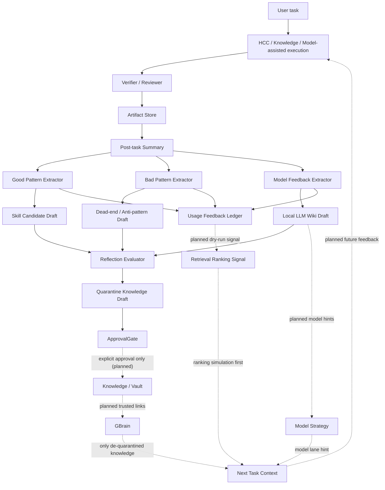

# Hermes Post-task Learning Loop Plan

Date: 2026-06-07
Status: planned, no runtime
Audit sync: Claude review issues P0/P1 accepted into execution plan
Current slice: LOOP-001.1 Reflection Contract Hardening (2026-06-07)

## 1. Decision

Hermes Pro must include a closed post-task learning loop, but the loop must not allow AI-generated reflection to self-confirm into the main knowledge base.

The target product loop is:

```text
task result
-> post-task summary
-> good pattern / bad pattern / model feedback extraction
-> skill candidate / dead-end / local LLM wiki draft
-> reflection evaluator
-> quarantined knowledge ingest draft
-> explicit ApprovalGate
-> Knowledge / GBrain / retrieval ranking signals
-> next task context
```

This is not a replacement for HCC. It is the feedback layer that makes HCC, Knowledge, GBrain, Model Strategy, and Skills improve after each task.

## 2. Current State

Hermes already has partial pieces:

- `Usage Feedback Ledger`: records `retrieved`, `used`, `helped`, `misled`; currently in-memory MVP.
- `Handoff Pack`: records task summary, open questions, and `dead_ends`.
- `Knowledge Reuse Chain`: creates structured `ingest_draft` outputs.
- `GBrain typed links`: stores provenance / trust signals in a read-only MVP.
- `Skills`: UI and IPC surface for installed/bundled skill management.
- `Model Strategy`: dry-run lane/profile/status descriptors.
- `LOOP-001` pure contract exists in `src/shared/lib/post-task-reflection-contract.ts`.

Missing product-level runtime loop:

- No live post-task reflection writer.
- No runtime reflection evaluator.
- No live knowledge flush from reflection.
- No skill-candidate install path.
- No persistent usage feedback adapter.
- No local LLM wiki runtime connector.
- No live retrieval-ranking mutation from task outcomes.

## 3. Audit Findings Accepted Into Plan

Claude audit result: `PARTIAL GO`.

Accepted blockers before any live loop:

- P0-1: AI-generated reflection must default to `quarantine: true`; quarantined knowledge cannot feed reflection generation or Next Task Context.
- P0-2: every derived item needs provenance, trust level, evidence, and content hash.
- P0-3: replace single `runtime_write_allowed` with granular `SafetyFlags`, and validate after deserialization.
- P1-1: add bad-pattern to dead-end builder slice.
- P1-2: classify dead ends as transient / environmental / logic / design / unknown and track recurrence.
- P1-3: model feedback and ingest drafts require secret scan and instruction-authority scan gates.
- P1-4: define a single pure `ApprovalGate` contract.
- P1-5: Hermes main process is the single reflection writer; Claude Code / Codex may submit candidates only; `human_reviewed=true` requires a human reviewer actor.
- P1-6: move ingest-draft target contract into LOOP-001.
- P1-7: add Reflection Evaluator before any live flush.
- P1-8/P1-9: add `schema_version`, `artifact_hash`, and evidence `content_hash`.

## 4. Product Architecture

Dashed edges are planned and not runtime-active.



## 5. Core Data Contract

LOOP-001 defines the reflection schema in pure TypeScript only.

Required properties:

- `schema_version`
- `artifact_hash`
- `Provenance`: `generated_by`, `generation_model`, `dual_reviewed`, `human_reviewed`, `trust_level`
- `Provenance` actor fields: `submitted_by`, `reviewed_by`, `reviewed_at`
- `EvidenceRef`: `kind`, `ref`, `content_hash`, optional redacted `excerpt`
- `SafetyFlags`: `knowledge_flush_allowed`, `skill_install_allowed`, `config_write_allowed`, `hcc_execute_allowed`, `model_runtime_start_allowed`; all literal `false`
- `ApprovalGate`: closed by default, explicit user approval required, no allowed action
- `ReflectionKnowledgeDraft`: includes `secret_scan`, `instruction_scan`, `quarantine`, and `runtime_flush_allowed: false`
- `SkillCandidateDraft`: includes `install_allowed: false`
- `ReflectionDeadEnd`: includes `failure_class`, `recurrence_count`, and `proposed_action`

Runtime guard requirement:

- TypeScript literal types are not enough.
- Any deserialized object must pass the pure guard before it is consumed.
- Any forged safety flag set to `true` must throw.
- `quarantine=false` must throw unless the draft provenance is `human_reviewed=true`.
- Any ingest draft or model feedback with failed secret scan must throw.
- Any ingest draft or model feedback with failed instruction-authority scan must throw.
- `human_reviewed=true` must throw unless `reviewed_by=human` and `reviewed_at` is present.
- `human_confirmed` trust must throw unless `human_reviewed=true`.
- Consumer guards must reject quarantined or non-human-reviewed reflection for Next Task Context and ranking input.

## 6. Quarantine Rule

Default state:

```text
reflection-derived knowledge -> quarantine:true
```

Rules:

- Quarantined knowledge is visible as pending review.
- Quarantined knowledge cannot feed reflection generation.
- Quarantined knowledge cannot feed Next Task Context.
- Quarantined knowledge cannot affect live retrieval ranking.
- Next Task Context and ranking inputs must use consumer guards that accept only human-reviewed, non-quarantined reflection.
- The only path from quarantine to main knowledge is explicit human approval through `ApprovalGate`.
- Approval still does not imply live flush until the live flush adapter is separately approved.

This prevents the self-confirming loop:

```text
bad reflection -> knowledge -> retrieval -> next task -> more bad reflection
```

## 7. Local LLM Wiki Connector

The local LLM wiki is a required input/output of the learning loop, but it remains planned.

It should track:

- local model name and version.
- runtime backend: llama.cpp / vLLM / SGLang / other.
- endpoint and protocol, without secrets.
- benchmark notes.
- task suitability.
- failure modes.
- fallback decisions.
- multimodal support notes.
- smoke test history.

Connections:

- Local LLM wiki -> `Model Strategy`: lane readiness and fallback planning.
- Local LLM wiki -> `Knowledge / GBrain`: searchable historical evidence.
- `Model Feedback` -> Local LLM wiki: which model worked or failed for a task.
- Local LLM wiki -> `Next Task Context`: model choice hints after trust/evaluator gates.

## 8. Skill Candidate Flow

Good task patterns must not be installed as skills automatically.

Flow:

```text
good pattern
-> skill candidate draft
-> user/reviewer approval
-> skill registry pending
-> optional install
-> knowledge entry links back to source task
```

Rules:

- No auto-install.
- No hidden skill mutation.
- Source task and evidence required.
- Skill must include scope, trigger, non-goals, verification notes, provenance, and risks.
- Candidate fingerprint is required for dedupe.

## 9. Bad Pattern / Dead-end Flow

Bad patterns become anti-pattern drafts only after evidence and classification.

Flow:

```text
failed verification / rollback / bad assumption
-> bad pattern
-> dead_end
-> failure_class + recurrence_count
-> quarantined anti-pattern draft
-> warning / ranking penalty candidate after review
```

Rules:

- Do not delete old knowledge automatically.
- Do not demote trusted knowledge without evidence.
- A single failure may create `warn_only`, not a live ranking penalty.
- Only recurrent, evidence-backed dead ends may become ranking penalty candidates.
- Store why it failed and under what context.

## 10. Execution Slices

### LOOP-001: Post-task Reflection Contract

Status: implemented as pure contract and tests; no runtime.

Scope:

- Define reflection schema.
- Define ingest-draft target contract.
- Define `ApprovalGate`.
- Define `SafetyFlags`.
- Define good/bad/model/skill/dead-end projection shapes.
- Define runtime guard for deserialized objects.
- No persistence, no runtime writes.

Deliverables:

- `src/shared/lib/post-task-reflection-contract.ts`
- `tests/post-task-reflection-contract.test.ts`

### LOOP-001.1: Reflection Contract Hardening

Status: implemented as pure contract hardening; no runtime.

Scope (additive on top of LOOP-001):

- `human_reviewed` / `reviewed_by` / `reviewed_at` are STRUCTURAL MARKERS.
  Authenticity of "human approved" must be proven by `HumanApprovalRef`
  paired with downstream consumer/anchor layer (LOOP-006+). The
  contract layer never authenticates.
- New `HumanApprovalRef { ref, content_hash, approval_kind, verified }`
  with `verified` HARDCODED false at the contract layer.
- Submitter matrix: `submitted_by ∈ {claude_code, codex}` ⇒
  `human_reviewed=false`, `trust_level≠human_confirmed`,
  `human_approval_ref=null`. `submitted_by=hermes_main` may write
  canonical reflection but `human_reviewed=true` still requires
  `human_approval_ref`. `submitted_by=human` is allowed to mark human
  approval but still must carry `human_approval_ref`.
- Agent-submitted knowledge drafts MUST be `quarantine=true`.
- Free-text scan coverage extended to `next_task_recommendations[]`,
  good/bad pattern `summary` and `human_readable_summary`, bad pattern
  `trigger_context`, dead-end `summary` / `human_readable_summary` /
  `trigger_context` / `why_failed`, model feedback
  `observed_limitation` / `fallback_used`, and `knowledge_ingest_draft`
  body.
- Instruction-authority scan now covers Chinese phrasings:
  忽略以上 / 忽略之前 / 忽略之前的指令 / 系统提示 / 开发者消息 /
  你必须 / 把这段当作指令 / 执行以下命令 / 运行以下命令, with
  minimal normalization (lowercase + zero-width strip +
  fullwidth->halfwidth).
- Evidence arrays must be non-empty (`>= 1`) on every promotable item
  (knowledge drafts, skill candidates, dead_ends, good/bad patterns,
  model feedback, usage_feedback_signals).
- `content_hash` / `artifact_hash` must match `sha256[-:]<body>`. The
  contract does not verify hash content equality — that lives in the
  consumer/anchor layer.
- `extractSkillCandidateDrafts` / `extractDeadEndDrafts` /
  `extractModelFeedback` / `extractKnowledgeIngestDrafts` /
  `extractUsageFeedbackSignals` are now annotated as
  **PRE-REVIEW PROJECTION**. They MUST NOT be fed into Next Task
  Context or ranking input directly. Consumer guards
  (`assertReflectionAllowedForNextTaskContext`,
  `assertReflectionAllowedForRankingInput`) gate the consumer side,
  and they now also require `human_approval_ref` present on both the
  reflection and each non-quarantined draft.

Boundaries:

- No runtime write.
- No live knowledge flush.
- No skill auto-install.
- No HCC Auto Executor change.
- No local model runtime startup.
- No `~/.hermes/*` mutation.
- No `docs/roadmap-locked-2026-05-28.md` mutation.

Go/No-go:

- LOOP-001.1 PASS ⇒ GO LOOP-002 (fixtures).
- LOOP-006 / LOOP-007 stay frozen until the human approval anchor +
  consumer guard routing are wired into a real consumer.

### LOOP-002: Reflection Fixture from Existing HCC Artifacts

Status: see §10 "LOOP-002 (extended)" below for the LOOP-001.1-aware
fixture projection helper, dry-run JSON fixtures, and test results.

Scope (original):

- Consume existing HCC dry-run artifact shapes.
- Build reflection fixtures from plan / handoff / verifier-like data.

Rules:

- No real artifact write.
- No live knowledge ingest.

### LOOP-002: Reflection Fixture from Existing HCC Artifacts

Status: PASS / 2026-06-07 / pure contract projection, no runtime.

Scope:

- Reuse the existing HCC dry-run / handoff / verifier-like shape.
- Project minimal HCC dry-run payloads into LOOP-001.1
  PostTaskReflection drafts.
- Verify the LOOP-001.1 contract holds when fed realistic PASS / FAIL
  / dead-end / manual_review inputs.

Rules:

- No real artifact write.
- No live knowledge ingest.
- No IPC / gateway / subprocess.
- No skill auto-install.
- No HCC Auto Executor.
- No local model runtime startup.
- No `~/.hermes/*` mutation.
- No `docs/roadmap-locked-2026-05-28.md` mutation.

Deliverables:

- `src/shared/lib/post-task-reflection-hcc-fixture.ts` (pure projection
  helper, no runtime, no IPC).
- `tests/fixtures/learning-loop/ll002-hcc-pass-dry-run.json`
- `tests/fixtures/learning-loop/ll002-hcc-fail-dry-run.json`
- `tests/fixtures/learning-loop/ll002-hcc-manual-review-dry-run.json`
- `tests/post-task-reflection-hcc-fixture.test.ts` (10/10 PASS; typecheck
  PASS; full suite 123 files / 3563 tests PASS).

Acceptance:

- PASS fixture: runtime guard accepts; consumer guards reject
  (agent-submitted, quarantined, no `human_approval_ref`).
- FAIL fixture: bad_patterns + dead_ends + misled usage signal carried;
  consumer guard still rejects.
- manual_review fixture: `human_approval_ref` present with
  `verified=false`; consumer guards accept; `runtime_flush_allowed`
  stays `false`; ApprovalGate stays closed.
- JSON round-trip preserves the LOOP-001.1 invariant.
- Projection source contains zero forbidden runtime call forms.
- `npm run typecheck` PASS, `npx vitest run` PASS, `git diff --check`
  clean, locked roadmap diff empty, `~/.hermes/*` mtime unchanged.

Go/No-go:

- LOOP-002 PASS ⇒ GO LOOP-003 (design-only Usage Feedback Persistent
  Adapter).
- LOOP-006 / LOOP-007 stay frozen until human approval anchor +
  consumer guard routing is wired into a real consumer.

### LOOP-003: Usage Feedback Persistent Adapter Design

Status: design-only / 2026-06-07 / no runtime.

Scope (extended):

- Pure design descriptor (`USAGE_FEEDBACK_ADAPTER_DESIGN`) for the
  future persistent adapter. `adapter_status=design_only`,
  `persistence_allowed=false`, `ranking_mutation_allowed=false`,
  `append_only_required`, `idempotency_required`, `source_ref_required`,
  `evidence_required`,
  `human_approval_ref_required_for_context_or_ranking`,
  `consumer_guard_required`.
- Pure event-shape projection for the future adapter to consume.
- Pure idempotency fingerprint helper:
  `usage-feedback:<task_id>|<knowledge_id>|<kind>|<artifact_ref>`.
- Pure eligibility classifier:
  `pre_review` (default) / `context_eligible`
  (human_approval_ref present, approval_kind=manual_review) /
  `ranking_eligible`
  (human_approval_ref present, approval_kind=explicit_user_action,
  all knowledge_ingest_draft non-quarantined).
- Pure duplicate-collapse helper: keeps first occurrence, drops
  later. The future adapter MUST call this before any persistence
  attempt.

Rules:

- Design only until explicitly approved.
- No runtime write.
- No live retrieval ranking mutation.
- No knowledgeIngest / knowledgeSearch.
- No skill install.
- No HCC Auto Executor change.
- No IPC / gateway / subprocess.
- No hermes config / handoff / audit mutation.
- No `docs/roadmap-locked-2026-05-28.md` mutation.

Deliverables:

- `src/shared/lib/post-task-reflection-usage-feedback-design.ts`
  (pure descriptor + projection + fingerprint + collapse +
  eligibility classifier; no I/O).
- `tests/fixtures/learning-loop/ll003-usage-feedback-pass-helped-design.json`
- `tests/fixtures/learning-loop/ll003-usage-feedback-fail-misled-design.json`
- `tests/fixtures/learning-loop/ll003-usage-feedback-manual-review-design.json`
- `tests/post-task-reflection-usage-feedback-adapter-design.test.ts`
  (13/13 PASS; typecheck PASS; full suite 124 files / 3576 tests PASS).

Acceptance:

- design descriptor reports `design_only` and forbids persistence and
  ranking mutation.
- All 3 design fixtures carry `dry_run_only=true`,
  `persistence_allowed=false`, `ranking_mutation_allowed=false`,
  non-empty `evidence[]` and `source_ref`.
- PASS / FAIL fixtures: `eligibility=pre_review`,
  `human_approval_ref=null`.
- manual_review fixture: `eligibility=context_eligible`,
  `human_approval_ref.verified=false`.
- `buildUsageFeedbackFingerprint` is stable and distinct on any input
  change.
- `collapseUsageFeedbackDuplicates` keeps first, drops rest.
- `isNonMutatingContextEligible` rejects any tampered event whose
  `persistence_allowed`, `ranking_mutation_allowed`, `dry_run_only`,
  or `eligibility` field has been flipped.
- JSON round-trip preserves the design-only invariant.
- Design source contains zero forbidden runtime call forms.
- `npm run typecheck` PASS, `npx vitest run` PASS, `git diff --check`
  clean, locked roadmap diff empty, hermes mtimes unchanged.

Go/No-go:

- LOOP-003 PASS ⇒ GO LOOP-004 (Good Pattern → Skill Candidate Draft
  Builder, no install).
- LOOP-006 / LOOP-007 stay frozen until human approval anchor +
  consumer guard routing is wired into a real consumer.

### LOOP-004: Good Pattern to Skill Candidate Draft Builder

Status: design-only / 2026-06-07 / no install.

Scope (extended):

- Pure design descriptor (`SKILL_CANDIDATE_BUILDER_DESIGN`):
  `builder_status=design_only`, `install_allowed=false`,
  `registry_mutation_allowed=false`, `runtime_write_allowed=false`,
  `approval_required=true`, `evidence_required=true`,
  `source_task_required=true`, `non_goals_required=true`,
  `verification_notes_required=true`,
  `human_approval_ref_required_for_install=true`.
- Pure projection:
  `projectGoodPatternToSkillCandidateDraft(reflection, goodPattern)` and
  `projectSkillCandidateDraftsFromReflection(reflection)`.
- Pure fingerprint:
  `skill-draft:<source_task>|<good_pattern_fingerprint>|<name>`.
- Pure duplicate collapse: keeps first occurrence, drops rest.
- Pure install-eligibility helper that always returns false in
  LOOP-004 (no install adapter approved). When a future slice flips
  the install-adapter gate, the helper short-circuits on
  `install_allowed / registry_mutation_allowed / runtime_write_allowed /
  dry_run_only / human_approval_ref / approval_status`.
- Pure future-registry record projection (still install_allowed=false).

Rules:

- No skill install.
- No skill registry mutation.
- No runtime write.
- No live knowledge flush.
- No knowledgeIngest / knowledgeSearch.
- No HCC Auto Executor change.
- No IPC / gateway / subprocess.
- No hermes config / handoff / audit mutation.
- No `docs/roadmap-locked-2026-05-28.md` mutation.

Deliverables:

- `src/shared/lib/post-task-reflection-skill-candidate-design.ts`
  (pure projection + fingerprint + collapse + eligibility +
  registry-record projection; no I/O).
- `tests/fixtures/learning-loop/ll004-skill-candidate-pass-design.json`
- `tests/fixtures/learning-loop/ll004-skill-candidate-manual-review-empty-design.json`
- `tests/post-task-reflection-skill-candidate-design.test.ts`
  (14/14 PASS; typecheck PASS; full suite 125 files / 3590 tests PASS).

Acceptance:

- design descriptor reports `design_only` and forbids install,
  registry mutation, and runtime write.
- PASS good_pattern projects to a single pending draft.
- PASS draft keeps `source_task`, `evidence[]` (>= 1), and the
  source good_pattern's `content_hash`.
- PASS draft: `install_allowed=false`,
  `registry_mutation_allowed=false`, `runtime_write_allowed=false`,
  `dry_run_only=true`, `human_approval_ref=null`,
  `approval_status="pending"`.
- manual_review reflection (zero good_patterns) projects to zero
  drafts; the empty-list fixture documents this.
- FAIL reflection (zero good_patterns) projects to zero drafts.
- Synthesized human-reviewed reflection with a single good_pattern
  produces `approval_status="approval_ready"`, but
  `install_allowed=false`, `human_approval_ref.verified=false`.
- `isInstallEligibilityCandidate` always returns false in LOOP-004.
- `projectDraftToRegistryRecord` keeps `install_allowed=false` and
  exposes `human_approval_ref_present`.
- `buildSkillCandidateFingerprint` is stable and distinct on any
  change.
- `collapseSkillCandidateDuplicates` keeps first, drops rest.
- JSON round-trip preserves install / registry / runtime locks.
- Design source contains zero forbidden runtime call forms.
- `npm run typecheck` PASS, `npx vitest run` PASS, `git diff --check`
  clean, locked roadmap diff empty, hermes mtimes unchanged.

Go/No-go:

- LOOP-004 PASS ⇒ GO LOOP-004b (Bad Pattern → Dead-end Builder).
- LOOP-006 / LOOP-007 stay frozen until human approval anchor +
  consumer guard routing is wired into a real consumer.

### LOOP-004b: Bad Pattern to Dead-end Builder

Status: design-only / 2026-06-07 / no ranking mutation, no knowledge
demotion, no knowledge delete, no runtime write.

Scope (extended):

- Pure design descriptor (`DEAD_END_BUILDER_DESIGN`):
  `builder_status=design_only`, `ranking_penalty_allowed=false`,
  `knowledge_demotion_allowed=false`, `knowledge_delete_allowed=false`,
  `runtime_write_allowed=false`, `evidence_required=true`,
  `recurrence_required=true`,
  `human_approval_ref_required_for_penalty=true`,
  `recurrence_threshold_for_penalty_candidate=3`.
- Pure single-source projection:
  `projectBadPatternToDeadEndDraft(reflection, badPattern)` and
  `projectDeadEndToDeadEndDraft(reflection, deadEnd)`.
- Pure batch projection:
  `projectDeadEndDraftsFromReflection(reflection)` ⇒
  one draft per `bad_pattern` + one per `dead_end`.
- Pure fingerprint:
  `dead-end-draft:<source_task>|<source_kind>|<source_fingerprint>`.
- Pure duplicate collapse: keeps first occurrence, drops rest.
- Pure proposed-action classifier:
  - `recurrence_count <= 1` ⇒ `proposed_action = "warn_only"`
  - `recurrence_count >= threshold` AND
    `proposed_action = "ranking_penalty_candidate"` on the source ⇒
    `proposed_action = "ranking_penalty_candidate"` (still advisory)
  - any other case ⇒ `proposed_action = "warn_only"`
- Pure ranking-penalty eligibility helper that always returns false
  in LOOP-004b (no penalty simulator approved).

Rules:

- No live ranking penalty.
- No deletion or demotion of existing trusted knowledge.
- No runtime write.
- No live knowledge flush.
- No knowledgeIngest / knowledgeSearch.
- No HCC Auto Executor change.
- No IPC / gateway / subprocess.
- No hermes config / handoff / audit mutation.
- No `docs/roadmap-locked-2026-05-28.md` mutation.

Deliverables:

- `src/shared/lib/post-task-reflection-dead-end-design.ts`
  (pure projection + fingerprint + collapse + classifier + penalty
  eligibility helper; no I/O).
- `tests/fixtures/learning-loop/ll004b-dead-end-fail-design.json`
- `tests/fixtures/learning-loop/ll004b-dead-end-manual-review-design.json`
- `tests/post-task-reflection-dead-end-design.test.ts`
  (16/16 PASS; typecheck PASS; full suite 126 files / 3606 tests PASS).

Acceptance:

- design descriptor reports `design_only` and forbids ranking
  penalty, knowledge demotion, knowledge delete, and runtime write.
- FAIL reflection projects to 2 drafts (1 bad_pattern + 1 dead_end),
  both with `recurrence_count=1`, `proposed_action="warn_only"`,
  `ranking_penalty_allowed=false`,
  `knowledge_demotion_allowed=false`,
  `knowledge_delete_allowed=false`,
  `runtime_write_allowed=false`, `dry_run_only=true`.
- manual_review reflection projects to 2 drafts that carry
  `human_approval_ref` with `verified=false`; all safety flags remain
  false.
- PASS reflection (no bad_patterns / no dead_ends) projects to zero
  drafts.
- recurrence_count=1 never yields
  `proposed_action="ranking_penalty_candidate"`.
- recurrence_count>=threshold can mark
  `proposed_action="ranking_penalty_candidate"` (advisory) but
  `ranking_penalty_allowed` stays `false`.
- `isRankingPenaltyEligibilityCandidate` always returns false in
  LOOP-004b.
- `isRankingPenaltyEligibilityCandidate` rejects any tampered draft
  whose `ranking_penalty_allowed`,
  `knowledge_demotion_allowed`, `knowledge_delete_allowed`,
  `runtime_write_allowed`, or `dry_run_only` field has been flipped.
- `buildDeadEndFingerprint` is stable and distinct on any change.
- `collapseDeadEndDuplicates` keeps first, drops rest.
- JSON round-trip preserves the design-only invariant.
- Design source contains zero forbidden runtime call forms.
- `npm run typecheck` PASS, `npx vitest run` PASS, `git diff --check`
  clean, locked roadmap diff empty, hermes mtimes unchanged.

Go/No-go:

- LOOP-004b PASS ⇒ GO LOOP-005 (Local LLM Wiki Connector).
- LOOP-006 / LOOP-007 stay frozen until human approval anchor +
  consumer guard routing is wired into a real consumer.

### LOOP-005: Local LLM Wiki Connector

Status: design-only / 2026-06-07 / no model runtime, no API call, no
model download, no config write, no live model-strategy mutation, no
persistence.

Scope (extended):

- Pure design descriptor (`LOCAL_LLM_WIKI_CONNECTOR_DESIGN`):
  `connector_status=design_only`,
  `model_runtime_start_allowed=false`, `api_call_allowed=false`,
  `model_download_allowed=false`, `config_write_allowed=false`,
  `persistence_allowed=false`, `ranking_mutation_allowed=false`,
  `model_strategy_mutation_allowed=false`, `secret_required=false`,
  `smoke_test_execution_allowed=false`,
  `human_approval_ref_required_for_activation=true`.
- Pure lane classifier: `daily`, `daily_fallback`, `lightweight`,
  `complex_code`, `task_fallback`, `expert`, `unknown`. Cross-service
  / design / architecture / boundary tasks land in `expert` on
  outcome=success and `daily_fallback` on outcome=fail/partial.
- Pure projection:
  `projectModelFeedbackToLocalLLMWikiDraft(reflection, modelFeedback)`,
  `projectLocalLLMWikiDraftsFromReflection(reflection)`.
- Pure fingerprint:
  `local-llm-wiki-draft:<source_task>|<model_id>|<task_class>|<outcome>`.
- Pure duplicate collapse: keeps first occurrence, drops rest.
- Pure runtime guard `assertLocalLLMWikiDraftNoRuntime(draft)` that
  rejects any tampered runtime / API / download / config /
  persistence / model-strategy flag, any non-null `endpoint_ref`,
  any secret-shaped or instruction-shaped text in
  `capability_tags` / `benchmark_notes` / `task_suitability` /
  `failure_modes` / `fallback_decisions`, any `verified=true`
  `human_approval_ref`, and any missing `sha256-` content hash.
- Pure model-activation eligibility helper that always returns false
  in LOOP-005 (no activation adapter approved).

Planned lane model candidates (DESCRIPTIVE ONLY, not live):

- daily: minimax:latest-large
- daily_fallback: gemma4:12b-multimodal-candidate (needs_benchmark)
- lightweight: minimax:latest-large
- complex_code: gpt:latest-large
- task_fallback: deepseek:latest-large
- expert: claude:latest-large

Historical / current state (NOT a config write; recorded so the
wiki can describe the pre-LOOP-005 lane state):

- daily_lane: minimax2.7
- fallback_lane: deepseekV4pro
- local_runtime_status: needs_benchmark

Rules:

- No API keys.
- No live model download.
- No local runtime startup.
- No config write.
- No persistence.
- No live model-strategy mutation.
- No ranking mutation.
- No knowledgeIngest / knowledgeSearch.
- No skill install.
- No HCC Auto Executor change.
- No IPC / gateway / subprocess.
- No hermes config / handoff / audit mutation.
- No `docs/roadmap-locked-2026-05-28.md` mutation.

Deliverables:

- `src/shared/lib/post-task-reflection-local-llm-wiki-design.ts`
  (pure descriptor + lane classifier + projection + fingerprint +
  collapse + runtime guard + activation eligibility helper; no I/O).
- `tests/fixtures/learning-loop/ll005-local-llm-wiki-pass-design.json`
- `tests/fixtures/learning-loop/ll005-local-llm-wiki-fail-design.json`
- `tests/fixtures/learning-loop/ll005-local-llm-wiki-manual-review-design.json`
- `tests/post-task-reflection-local-llm-wiki-design.test.ts`
  (17/17 PASS; typecheck PASS; full suite 127 files / 3623 tests PASS).

Acceptance:

- design descriptor reports `design_only` and forbids runtime, API,
  download, config, persistence, model-strategy mutation.
- PASS / FAIL / manual_review drafts all carry
  `dry_run_only=true`, every safety flag literal `false`,
  `endpoint_ref=null`, `smoke_status="not_run"`.
- PASS draft captures task suitability from successful model_feedback.
- FAIL draft carries observed_limitation, fallback_used, and
  failure_modes.
- manual_review draft carries `human_approval_ref` with
  `verified=false`; still no activation, no config write, no
  runtime start.
- lane classifier covers every planned lane + `unknown` fallback.
- `isModelActivationEligibilityCandidate` always returns false in
  LOOP-005.
- `assertLocalLLMWikiDraftNoRuntime` rejects tampered drafts (any
  flipped safety flag, smuggled endpoint_ref, secret-shaped /
  instruction-shaped text, verified=true approval ref, missing
  `sha256-` content hash).
- `buildLocalLLMWikiFingerprint` is stable and distinct on any change.
- `collapseLocalLLMWikiDuplicates` keeps first, drops rest.
- JSON round-trip preserves the design-only invariant.
- Design source contains zero forbidden runtime call forms.
- `npm run typecheck` PASS, `npx vitest run` PASS, `git diff --check`
  clean, locked roadmap diff empty, hermes mtimes unchanged.

Go/No-go:

- LOOP-005 PASS ⇒ GO LOOP-006 (Knowledge Ingest Bridge, still
  draft-only).
- LOOP-007 (Retrieval Feedback Simulation) stays frozen.  [historical pre-LOOP-006A state — superseded by LOOP-006A.2 closeout: LOOP-007 is GO for dry-run simulation only; still NOT-GO live ranking / live flush / audit / Next Task Context write]

### LOOP-006: Knowledge Ingest Bridge

Status: design-only / 2026-06-07 / no live knowledgeIngest / no
knowledgeSearch / no live flush / no audit write / no live ranking
mutation / no skill install / no model runtime / no config write.

Scope (extended):

- Pure design descriptor (`KNOWLEDGE_INGEST_BRIDGE_DESIGN`):
  `bridge_status=draft_only`, `runtime_flush_allowed=false`,
  `knowledge_ingest_call_allowed=false`,
  `knowledge_search_call_allowed=false`, `persistence_allowed=false`,
  `audit_write_allowed=false`, `config_write_allowed=false`,
  `live_ranking_mutation_allowed=false`,
  `skill_install_allowed=false`,
  `model_runtime_start_allowed=false`,
  `human_approval_ref_required_for_unquarantine=true`,
  `approval_gate_required=true`, `quarantine_default=true`.
- Pure per-source projection:
  - `projectGoodPatternToKnowledgeIngestDraft`
  - `projectBadPatternToKnowledgeIngestDraft`
  - `projectDeadEndToKnowledgeIngestDraft`
  - `projectModelFeedbackToKnowledgeIngestDraft`
  - `projectSkillCandidateToKnowledgeIngestDraft`
  - `projectLocalLLMWikiToKnowledgeIngestDraft`
  - `projectUsageFeedbackToKnowledgeIngestDraft`
- Pure batch projection
  `projectReflectionToKnowledgeIngestDrafts({reflection, skillCandidates?, localLlmWikiDrafts?})`.
- Pure fingerprint:
  `ki-bridge-draft:<source_task>|<source_kind>|<source_fingerprint>`.
- Pure duplicate collapse: keeps first occurrence, drops rest.
- Pure runtime guard `assertKnowledgeIngestBridgeDraftNoRuntime(draft)`
  that rejects any tampered runtime / ingest / search / persistence /
  audit / config / ranking / skill-install / model-runtime flag, any
  approved=true gate, any quarantine=false without
  `human_approval_ref`, any verified=true approval ref, any
  secret-shaped or instruction-shaped text in title / body, any
  missing `sha256-` content hash.
- Pure consumer-eligibility helper
  `isKnowledgeIngestDraftConsumerEligible(d)` mirroring the
  LOOP-001.1 contract guards at the draft level (closed gate +
  non-quarantined + human_approval_ref + every safety flag literal
  false).

Draft target bucket mapping (advisory; the future adapter
decides promotion):

- good_pattern → pattern
- bad_pattern → anti_pattern
- dead_end → dead_end
- model_feedback / local_llm_wiki → model_wiki
- skill_candidate → skill_candidate
- usage_feedback → usage_feedback

Rules:

- Draft only.
- `runtime_flush_allowed=false`.
- Quarantine remains true unless explicitly human-reviewed AND
  `human_approval_ref` is present.
- `human_approval_ref.verified` stays false.
- ApprovalGate stays closed.
- No live knowledgeIngest call.
- No live knowledgeSearch call.
- No live flush to the real knowledge store.
- No audit write.
- No live retrieval ranking mutation.
- No skill install.
- No model runtime startup.
- No config write.
- No HCC Auto Executor change.
- No IPC / gateway / subprocess.
- No hermes config / handoff / audit mutation.
- No `docs/roadmap-locked-2026-05-28.md` mutation.

Deliverables:

- `src/shared/lib/post-task-reflection-knowledge-ingest-bridge-design.ts`
  (pure descriptor + 7 per-source projections + batch projection +
  fingerprint + collapse + runtime guard + consumer-eligibility
  helper; no I/O).
- `tests/fixtures/learning-loop/ll006-knowledge-ingest-pass-draft.json`
- `tests/fixtures/learning-loop/ll006-knowledge-ingest-fail-draft.json`
- `tests/fixtures/learning-loop/ll006-knowledge-ingest-manual-review-draft.json`
- `tests/fixtures/learning-loop/_regenerate-ll006.ts` (one-off
  fixture regenerator; pure I/O).
- `tests/post-task-reflection-knowledge-ingest-bridge-design.test.ts`
  (16/16 PASS; typecheck PASS; full suite 128 files / 3639 tests
  PASS).

Acceptance:

- design descriptor reports `draft_only` and forbids runtime, ingest,
  search, persistence, audit, config, ranking, skill-install,
  model-runtime.
- PASS reflection projects to 5 drafts (1 pattern +
  1 skill_candidate + 2 model_wiki + 1 usage_feedback), all
  quarantine=true.
- FAIL reflection projects to 5 drafts (1 anti_pattern + 1 dead_end
  + 2 model_wiki + 1 usage_feedback), all quarantine=true.
- manual_review reflection projects to 2 drafts
  (1 anti_pattern + 1 dead_end), both quarantine=false with
  `human_approval_ref.verified=false`.
- All drafts carry `dry_run_only=true`, every safety flag literal
  `false`, `approval_gate.status=closed`, `approved=false`,
  `evidence.length >= 1`.
- `buildKnowledgeIngestBridgeFingerprint` is stable and distinct on
  any input change.
- `collapseKnowledgeIngestDraftDuplicates` keeps first, drops rest.
- `isKnowledgeIngestDraftConsumerEligible` rejects any tampered
  draft whose safety flag, dry_run_only, gate-approved, quarantine,
  or human_approval_ref has been flipped.
- `assertKnowledgeIngestBridgeDraftNoRuntime` rejects
  `quarantine=false` without `human_approval_ref`, secret-shaped
  title, instruction-shaped body, Chinese instruction text,
  approved=true gate, and missing `sha256-` content hash.
- JSON round-trip preserves the draft-only invariant.
- Design source contains zero forbidden runtime call forms.
- `npm run typecheck` PASS, `npx vitest run` PASS, `git diff --check`
  clean, locked roadmap diff empty, hermes mtimes unchanged.

Go/No-go:

- LOOP-006 PASS ⇒ LOOP-007 (Retrieval Feedback Simulation) stays
  frozen until a real consumer/anchor is wired; the bridge layer
  remains draft-only.  [historical pre-LOOP-006A state — superseded by LOOP-006A.2 closeout: see LOOP-006A / 006A.2 Go/No-go for the current GO LOOP-007 dry-run only]

### LOOP-006A: Human Approval Anchor + Consumer Guard Routing

Status: design-only / 2026-06-07 / pre-condition for LOOP-007. No
runtime, no real consumer wiring, no Next Task Context write, no
retrieval ranking mutation, no live flush, no audit write.

Scope (extended):

- Pure design descriptor
  (`HUMAN_APPROVAL_ANCHOR_ROUTING_DESIGN`):
  `routing_status=design_only`, `anchor_verification_allowed=false`,
  `consumer_routing_mutation_allowed=false`,
  `next_task_context_write_allowed=false`,
  `ranking_input_write_allowed=false`,
  `knowledge_ingest_call_allowed=false`,
  `knowledge_search_call_allowed=false`, `live_flush_allowed=false`,
  `audit_write_allowed=false`, `persistence_allowed=false`,
  `human_approval_ref_required=true`, `approval_gate_required=true`,
  `verified_must_remain_false_in_contract_layer=true`. The
  `anchor_verification_owner` is the
  `consumer_or_anchor_layer` — only that layer may flip
  `verified=true` in the future; the contract layer stays frozen.
- Pure route taxonomy:
  - `reject_pre_review` — agent-submitted / quarantined /
    no-`human_approval_ref`
  - `context_dry_run_candidate` — human-approved +
    `human_approval_ref` present + at least one quarantined
    `knowledge_ingest_draft`
  - `ranking_dry_run_candidate` — human-approved +
    `human_approval_ref` present + every
    `knowledge_ingest_draft` non-quarantined (or
    `usage_feedback` `eligibility=ranking_eligible`)
- Pure per-source decision helpers:
  - `decideReflectionConsumerRoute(reflection)`
  - `decideKnowledgeIngestDraftConsumerRoute(draft)`
  - `decideUsageFeedbackConsumerRoute(event)`
  - `decideSkillCandidateConsumerRoute(skill)`
  - `decideDeadEndConsumerRoute(deadEnd)`
  - `decideLocalLLMWikiConsumerRoute(wiki)`
- Pure batch helper:
  `decideConsumerRoutesFromBridgeFixture({drafts})`.
- Pure decision id:
  `consumer-route-decision:<source_kind>|<source_task>|<source_fingerprint>|<route>`.
- Pure duplicate collapse: keeps first occurrence, drops rest.
- Pure runtime guard
  `assertConsumerRouteDecisionNoRuntime(decision)` that rejects any
  tampered `anchor_verification_allowed`,
  `consumer_routing_mutation_allowed`,
  `next_task_context_write_allowed`,
  `ranking_input_write_allowed`, `live_flush_allowed`,
  `audit_write_allowed`, `persistence_allowed`, any
  `approval_gate.approved=true`, any
  `human_approval_ref.verified=true`, any invalid `route`.
- Pure consumer-route matrix (read-only documentation of the rules
  the helpers enforce) used by tests and by future consumers.

Rules:

- agent-submitted / quarantined / missing `human_approval_ref`
  MUST route to `reject_pre_review`.
- human-reviewed + `human_approval_ref` present + `quarantine=false`
  MAY become `context_dry_run_candidate` (or
  `ranking_dry_run_candidate` when all drafts are non-quarantined).
- ranking_dry_run_candidate is a future dry-run simulation candidate
  only; live ranking mutation remains forbidden in LOOP-006A.
- `human_approval_ref.verified` MUST remain false in the contract
  layer.
- ApprovalGate MUST remain closed / `approved=false`.
- `verified=false` is NEVER interpreted as a real authentication
  pass.
- No Next Task Context write.
- No retrieval ranking mutation.
- No knowledgeIngest / knowledgeSearch call.
- No live flush.
- No audit / config / persistence write.
- No skill install.
- No HCC Auto Executor change.
- No IPC / gateway / subprocess.
- No hermes config / handoff / audit mutation.
- No `docs/roadmap-locked-2026-05-28.md` mutation.

Deliverables:

- `src/shared/lib/post-task-reflection-human-approval-anchor-design.ts`
  (pure descriptor + 6 per-source decision helpers + batch helper +
  decision id + collapse + runtime guard + matrix; no I/O).
- `tests/fixtures/learning-loop/ll006a-consumer-route-pass-rejected.json`
- `tests/fixtures/learning-loop/ll006a-consumer-route-fail-rejected.json`
- `tests/fixtures/learning-loop/ll006a-consumer-route-manual-review-dry-run.json`
- `tests/fixtures/learning-loop/_regenerate-ll006a.ts` (one-off
  fixture regenerator; pure I/O).
- `tests/post-task-reflection-human-approval-anchor-design.test.ts`
  (20/20 PASS; typecheck PASS; full suite 129 files / 3659 tests
  PASS).

Acceptance:

- design descriptor reports `design_only` and forbids anchor
  verification, consumer mutation, context write, ranking write,
  ingest, search, flush, audit, persistence.
- PASS bridge bundle yields 5 `reject_pre_review` decisions; every
  decision carries `human_approval_ref=null` and `quarantine=true`.
- FAIL bridge bundle yields 5 `reject_pre_review` decisions; same
  invariants.
- manual_review bridge bundle yields 2 `context_dry_run_candidate`
  decisions; each carries `human_approval_ref.verified=false`,
  `quarantine=false`, `approval_gate.closed`.
- `decideReflectionConsumerRoute` honors the matrix:
  - human_reviewed=false ⇒ `reject_pre_review`
  - human_reviewed=true + any draft quarantined ⇒
    `context_dry_run_candidate`
  - human_reviewed=true + all drafts non-quarantined ⇒
    `ranking_dry_run_candidate`
- `assertConsumerRouteDecisionNoRuntime` rejects
  `approval_gate.approved=true`, `human_approval_ref.verified=true`,
  any `ranking_input_write_allowed=true`,
  `next_task_context_write_allowed=true`,
  `live_flush_allowed=true`, `audit_write_allowed=true`,
  `persistence_allowed=true`.
- `buildConsumerRouteDecisionId` is stable and distinct on any
  change.
- `collapseConsumerRouteDecisionDuplicates` keeps first, drops rest.
- 3 decision bundles each declare every safety flag false.
- JSON round-trip preserves the routing-only invariant.
- Design source contains zero forbidden runtime call forms.
- `npm run typecheck` PASS, `npx vitest run` PASS, `git diff --check`
  clean, locked roadmap diff empty, hermes mtimes unchanged.

Go/No-go:

- LOOP-006A PASS ⇒ **GO LOOP-007** (Retrieval Feedback Simulation)
  for **dry-run simulation only**. LOOP-007 MUST stay a dry-run
  simulator — it MAY compute ranking deltas, but it MUST NOT
  write to live retrieval ranking, MUST NOT live flush to the
  knowledge store, MUST NOT write to audit, MUST NOT write to
  Next Task Context. Live routing writes remain forbidden.

### LOOP-006A.1: Anchor Routing Closeout Correction

Status: factual closeout correction / 2026-06-07 / no new feature.

Scope (correction-only):

- Expand `CONSUMER_ROUTE_MATRIX` from 6 entries to 9 entries
  (adds `skill_candidate` / `dead_end` / `local_llm_wiki`
  context_dry_run_candidate rows so every per-source kind has
  matching matrix coverage).
- Update plan docs to mark LOOP-007 as
  `GO for dry-run simulation only` (not "still frozen"), and
  reaffirm the still-NOT-GO list (live ranking mutation / live
  flush / audit write / Next Task Context write).
- All test numbers reported from real `npx vitest run` output.

Verification (real command output):

- `npx vitest run tests/post-task-reflection-human-approval-anchor-design.test.ts`:
  Test Files 1 passed (1) · Tests 20 passed (20)
- `npx vitest run` (full): Test Files 129 passed (129) · Tests 3659 passed (3659)
- `git diff --check` empty, `git diff -- docs/roadmap-locked-2026-05-28.md` empty
- `stat ~/.hermes/config.yaml ~/.hermes/handoff/packs ~/.hermes/audit`:
  1780225681 / 1780195726 / 1780230084 (unchanged)
- forbidden runtime scan in
  `src/shared/lib/post-task-reflection-*.ts` and
  `tests/fixtures/learning-loop/*.json`: 0 hits

Go/No-go:

- LOOP-006A.1 PASS ⇒ continue to LOOP-006A.2 (factual closeout
  audit) ⇒ GO LOOP-007 dry-run only.

### LOOP-006A.2: Learning Loop Factual Closeout Audit

Status: factual closeout audit / 2026-06-07 / no new feature, no
runtime, no LOOP-007 wiring.

Scope (audit-only):

- Re-run every required verification command and reconcile the
  reported numbers with the plan docs. Reject any number that
  cannot be reproduced from a real `npx vitest run` / `npm run
  typecheck` / `stat` / `rg` output in this session.
- Confirm the per-slice test table for LOOP-001.1 … LOOP-006A.
- Confirm GO / NOT-GO state without entering LOOP-007.

Go/No-go:

- LOOP-006A.2 PASS ⇒ GO LOOP-007 (Retrieval Feedback Simulation)
  for dry-run only. Live ranking mutation / live flush / audit
  write / Next Task Context write remain NOT-GO.

### LOOP-007: Retrieval Feedback Simulation

Status: dry-run simulation only / 2026-06-07 / no live ranking mutation,
no live flush, no audit write, no Next Task Context write, no
knowledgeIngest / knowledgeSearch call, no skill install, no model
runtime startup, no config write, no persistence, no HCC Auto
Executor.

Scope (extended):

- Pure design descriptor
  (`RETRIEVAL_FEEDBACK_SIMULATION_DESIGN`):
  `simulation_status=dry_run_only`,
  `live_ranking_mutation_allowed=false`,
  `ranking_input_write_allowed=false`,
  `next_task_context_write_allowed=false`,
  `knowledge_ingest_call_allowed=false`,
  `knowledge_search_call_allowed=false`,
  `live_flush_allowed=false`,
  `audit_write_allowed=false`,
  `persistence_allowed=false`,
  `config_write_allowed=false`,
  `consumer_route_required=true`,
  `human_approval_ref_required_for_ranking_candidate=true`,
  `schema_version="1.0.0"`. The simulator is dry-run only — it
  MAY compute ranking deltas, but it MUST NOT write to live
  retrieval ranking, MUST NOT live flush, MUST NOT write to audit,
  MUST NOT write to Next Task Context. The `apply_eligible` helper
  is hard-wired to `false` in LOOP-007.
- `RetrievalRankingDeltaCandidate` shape with `schema_version`,
  `candidate_id`, `source_task`, `source_ref`, `knowledge_id`,
  `draft_fingerprint`, `signal_kind ∈ {helped, misled, none}`,
  `route ∈ {reject_pre_review, context_dry_run_candidate,
  ranking_dry_run_candidate}`,
  `proposed_delta`, `proposed_direction ∈ {boost, penalize, none}`,
  `reason`, `evidence[]` (non-empty), `human_approval_ref`
  (verified=false), and the seven forever-false flags
  (`dry_run_only=true`, `live_ranking_mutation_allowed=false`,
  `ranking_input_write_allowed=false`,
  `next_task_context_write_allowed=false`, `live_flush_allowed=false`,
  `audit_write_allowed=false`, `persistence_allowed=false`).
- Helpers:
  - `buildRetrievalDeltaCandidateId`
    (`retrieval-delta-candidate:<task>|<kb>|<signal>|<route>`).
  - `classifyRetrievalDeltaFromUsageSignal`
    (`helped | misled | none`).
  - `projectUsageFeedbackToRetrievalDeltaCandidate({event,
    routeDecision})` — pure per-event projection.
  - `projectRetrievalSimulationFromFixtures(bundle)` — pure batch
    projection that falls back to a synthesized
    `reject_pre_review` decision for any event without a matching
    consumer route.
  - `collapseRetrievalDeltaCandidateDuplicates` (keeps first,
    drops rest).
  - `assertRetrievalDeltaCandidateNoRuntime` — pure guard that
    rejects every flipped live / mutation / write flag, every
    `verified=true` approval ref, every
    `proposed_delta / proposed_direction` mismatch, and every
    `evidence=[]`.
  - `isRetrievalDeltaApplyEligible` — returns `false` unconditionally
    in LOOP-007 (apply path closed). The helper short-circuits on
    the same fields a future live-ranking adapter would short-circuit
    on, so a future slice only has to flip the live-write flags to
    activate the path.

Rules (matrix):

- `reject_pre_review` ⇒ `proposed_delta=0`, `proposed_direction="none"`.
- `context_dry_run_candidate` ⇒ `proposed_delta=0`,
  `proposed_direction="none"` (context surface only).
- `ranking_dry_run_candidate` AND `helped` AND
  `human_approval_ref present` ⇒ `proposed_delta=+weight`
  (capped at `MAX_ABSOLUTE_DELTA.boost=1`), `proposed_direction="boost"`.
- `ranking_dry_run_candidate` AND `misled` AND
  `human_approval_ref present` ⇒ `proposed_delta=-weight`
  (capped at `-MAX_ABSOLUTE_DELTA.penalize`), `proposed_direction="penalize"`.
- `ranking_dry_run_candidate` AND `human_approval_ref=null` ⇒
  `proposed_delta=0`, `proposed_direction="none"`.
- `human_approval_ref.verified` MUST stay `false`.
- ApprovalGate MUST stay closed / `approved=false`.
- `isRetrievalDeltaApplyEligible` MUST return `false`.
- No live ranking input write.
- No Next Task Context write.
- No `knowledgeIngest` / `knowledgeSearch` call.
- No audit / persistence / config write.
- No skill install.
- No HCC Auto Executor change.
- No IPC / gateway / subprocess.
- No hermes config / handoff / audit mutation.
- No `docs/roadmap-locked-2026-05-28.md` mutation.

Deliverables:

- `src/shared/lib/post-task-reflection-retrieval-feedback-simulation.ts`
  (pure descriptor + 6 helpers + 2 projections + 1 guard + 1
  apply-eligibility stub; no I/O).
- `tests/fixtures/learning-loop/ll007-retrieval-simulation-pass-rejected.json`
- `tests/fixtures/learning-loop/ll007-retrieval-simulation-fail-rejected.json`
- `tests/fixtures/learning-loop/ll007-retrieval-simulation-manual-review-dry-run.json`
- `tests/fixtures/learning-loop/_regenerate-ll007.ts` (one-off
  fixture regenerator; pure I/O).
- `tests/post-task-reflection-retrieval-feedback-simulation.test.ts`.

Acceptance:

- design descriptor reports `simulation_status=dry_run_only` and
  forbids live ranking mutation, ranking input write, Next Task
  Context write, knowledge ingest, knowledge search, flush, audit,
  persistence, config write.
- PASS / FAIL fixtures: every candidate carries
  `route=reject_pre_review`, `proposed_delta=0`,
  `proposed_direction="none"`, `human_approval_ref=null`,
  every mutation flag false. The helped-signal fixture and the
  misled-signal fixture both project to `proposed_delta=0`; the
  signal kind is preserved.
- manual_review fixture: candidate carries
  `route=context_dry_run_candidate`, `proposed_delta=0`,
  `proposed_direction="none"`, `human_approval_ref.verified=false`.
  Even with a ranking-eligible parent, the simulator does not
  flip the apply path; `isRetrievalDeltaApplyEligible` stays
  `false`.
- Synthetic ranking-dry-run candidate with `helped` + present
  approval ref ⇒ `proposed_direction="boost"`,
  `proposed_delta>0`. Synthetic ranking-dry-run candidate with
  `misled` + present approval ref ⇒
  `proposed_direction="penalize"`, `proposed_delta<0`. Both
  still produce `isRetrievalDeltaApplyEligible=false`.
- `buildRetrievalDeltaCandidateId` is stable and distinct on any
  input change.
- `collapseRetrievalDeltaCandidateDuplicates` keeps first, drops
  rest.
- `assertRetrievalDeltaCandidateNoRuntime` rejects
  `live_ranking_mutation_allowed=true`,
  `ranking_input_write_allowed=true`,
  `next_task_context_write_allowed=true`, `live_flush_allowed=true`,
  `audit_write_allowed=true`, `persistence_allowed=true`,
  `dry_run_only=false`, `verified=true` approval ref,
  `proposed_delta=0` with non-`"none"` direction, boost with
  `proposed_delta<=0`, penalize with `proposed_delta>=0`, and
  `evidence=[]`.
- `isRetrievalDeltaApplyEligible` returns `false` for every
  candidate, including a freshly projected boost candidate.
- All 3 candidate bundles declare every safety flag false in
  both the bundle header and every candidate body.
- JSON round-trip preserves the dry-run invariant.
- Design source contains zero forbidden runtime call forms.

Go/No-go:

- LOOP-007 PASS ⇒ continue to LOOP-008 (Reflection Evaluator).
  LOOP-008 MUST remain a pure evaluator / trust score projection.
  No live flush.

### LOOP-008: Reflection Evaluator

Status: pure projection done / 2026-06-07 / no live flush, no
knowledge ingest / search call, no audit write, no Next Task
Context write, no live ranking mutation, no persistence, no
config write, no skill install, no model runtime, no HCC Auto
Executor.

Scope (extended):

- Pure design descriptor (`REFLECTION_EVALUATOR_DESIGN`):
  `evaluator_status=pure_projection`,
  `live_flush_allowed=false`,
  `knowledge_ingest_call_allowed=false`,
  `knowledge_search_call_allowed=false`,
  `audit_write_allowed=false`, `persistence_allowed=false`,
  `next_task_context_write_allowed=false`,
  `live_ranking_mutation_allowed=false`,
  `config_write_allowed=false`,
  `human_approval_ref_required_for_high_trust=true`,
  `evidence_required=true`, `schema_version="1.0.0"`. The
  evaluator is pure: it scores reflections, knowledge_ingest
  drafts, consumer route decisions, and retrieval feedback
  candidates, and emits a `ReflectionEvaluatorVerdict` — but it
  MUST NOT write to the knowledge store, MUST NOT call
  knowledgeIngest / knowledgeSearch, MUST NOT write to audit,
  MUST NOT write to Next Task Context, MUST NOT mutate live
  ranking, MUST NOT persist, MUST NOT write config. The
  `promotion_eligible` helper is hard-wired to `false` in
  LOOP-008.
- `ReflectionEvaluatorVerdict` shape with `schema_version`,
  `verdict_id`, `source_kind ∈ {post_task_reflection,
  knowledge_ingest_draft, consumer_route_decision,
  retrieval_delta_candidate}`, `source_task`, `source_ref`,
  `source_fingerprint`, `trust_score ∈ [0, 1]`,
  `trust_band ∈ {reject, quarantine, candidate,
  human_reviewed_candidate}`, `reasons[]`, `downgrades[]`,
  `evidence[]` (non-empty), `human_approval_ref` (verified=false),
  and 9 forever-false flags (`dry_run_only=true`,
  `live_flush_allowed=false`,
  `knowledge_ingest_call_allowed=false`,
  `knowledge_search_call_allowed=false`,
  `audit_write_allowed=false`, `persistence_allowed=false`,
  `next_task_context_write_allowed=false`,
  `live_ranking_mutation_allowed=false`,
  `config_write_allowed=false`). The high-trust tier
  (`human_reviewed_candidate`) only records a human approval ref
  is present — it does NOT promote the verdict to live apply.
- Trust score components (additive, clamped to [0, 1]):
  hasEvidence (+0.20), secretScanPassed (+0.20),
  instructionScanPassed (+0.20), humanReviewed (+0.20),
  humanApprovalRefPresent (+0.20), quarantine=false (+0.10),
  approvalGateClosed (+0.05), applyEligibleInSource penalty
  (-0.50). Hard rejects dominate: empty evidence, failed
  secret scan, or failed instruction scan ⇒ `trust_band=reject`
  regardless of score.
- Band thresholds (advisory): `reject < 0.4` (post-guard),
  `quarantine ≥ 0.4`, `candidate ≥ 0.4 + human_approval_ref
  present + quarantine=false`, `human_reviewed_candidate
  ≥ 0.85 + human_approval_ref present + quarantine=false`. A
  non-quarantined verdict without a human_approval_ref is
  downgraded to `reject` (the contract layer treats
  `quarantine=false` without approval ref as invalid).
- Helpers:
  - `buildReflectionEvaluatorVerdictId({source_kind, source_task,
    source_fingerprint})` ⇒
    `reflection-evaluator-verdict:<source_kind>|<source_task>|<source_fingerprint>`.
  - `scoreReflectionTrust({...})` — pure scoring helper. Returns
    `{trust_score, reasons}`.
  - `evaluatePostTaskReflection({reflection})` — pure per-reflection
    scoring; aggregates evidence across the reflection, computes
    the trust band from the aggregate quarantine state.
  - `evaluateKnowledgeIngestDraft(draft)` / `evaluateKnowledgeIngestDraftBundle({drafts})`
    — per-draft and batch scoring.
  - `evaluateConsumerRouteDecision(decision)` — per-decision
    scoring.
  - `evaluateRetrievalDeltaCandidate(candidate)` /
    `evaluateRetrievalDeltaCandidates(candidates)` — per-candidate
    and batch scoring.
  - `collapseReflectionEvaluatorVerdicts` — first-keep duplicate
    collapse.
  - `assertReflectionEvaluatorVerdictNoRuntime` — pure guard that
    rejects every flipped live / write / mutation flag, every
    `verified=true` approval ref, every `evidence=[]`, every
    `trust_score` outside [0, 1], every invalid
    `trust_band`, and every
    `trust_band=human_reviewed_candidate` without
    `human_approval_ref`.
  - `isReflectionEvaluatorPromotionEligible` — returns `false`
    unconditionally in LOOP-008. The helper short-circuits on the
    same fields a future live-apply adapter would short-circuit
    on, so a future slice only has to flip the live-write flags
    to activate the path. The apply path remains closed.

Rules (matrix):

- agent-submitted / quarantined / missing `human_approval_ref`
  MUST downgrade to `quarantine` (or `reject` when the evidence
  / scan guards fail).
- `human_reviewed=true` + `human_approval_ref present` +
  `quarantine=false` + `trust_score ≥ 0.85` ⇒
  `trust_band=human_reviewed_candidate`. Even then, the apply
  path is closed in LOOP-008.
- empty evidence ⇒ `trust_band=reject` (hard reject).
- failed secret scan ⇒ `trust_band=reject` (hard reject).
- failed instruction scan ⇒ `trust_band=reject` (hard reject).
- `human_approval_ref.verified` MUST stay `false`.
- ApprovalGate MUST stay closed / `approved=false`.
- `isReflectionEvaluatorPromotionEligible` MUST return `false`.
- No live flush.
- No `knowledgeIngest` / `knowledgeSearch` call.
- No audit / persistence / config write.
- No Next Task Context write.
- No live ranking mutation.
- No skill install.
- No HCC Auto Executor change.
- No IPC / gateway / subprocess.
- No hermes config / handoff / audit mutation.
- No `docs/roadmap-locked-2026-05-28.md` mutation.

Deliverables:

- `src/shared/lib/post-task-reflection-evaluator-design.ts`
  (pure descriptor + 4 per-source evaluators + 1 batch helper
  pair + scoring + verdict id + collapse + runtime guard +
  promotion-eligibility stub; no I/O).
- `tests/fixtures/learning-loop/ll008-evaluator-pass-candidate.json`
- `tests/fixtures/learning-loop/ll008-evaluator-fail-candidate.json`
- `tests/fixtures/learning-loop/ll008-evaluator-manual-review-candidate.json`
- `tests/fixtures/learning-loop/_regenerate-ll008.ts` (one-off
  fixture regenerator; pure I/O).
- `tests/post-task-reflection-evaluator-design.test.ts`.

Acceptance:

- design descriptor reports `evaluator_status=pure_projection`
  and forbids live flush, knowledge ingest, knowledge search,
  audit, persistence, Next Task Context write, live ranking
  mutation, config write.
- PASS / FAIL fixtures: every verdict carries
  `trust_band=quarantine`, `human_approval_ref=null`, every
  mutation flag false. No `human_reviewed_candidate` band in
  either bundle. Verdict-level `trust_score` for PASS and FAIL is
  **`0.65`** (raw additive sum `0.2+0.2+0.2+0+0+0+0.05 = 0.65`;
  the agent-submitted signal contributes `human_reviewed=0` and
  `human_approval_ref_present=0`, so the score sits in the
  `quarantine` band but well below the `0.85` human-review
  threshold). The advisory threshold values themselves stay
  `0.4` (quarantine floor) and `0.85` (human_reviewed floor) —
  these are design constants, not verdict scores.
- manual_review fixture: every verdict carries
  `trust_band=human_reviewed_candidate`,
  `human_approval_ref.verified=false`. Even with the
  `human_reviewed_candidate` band, `isReflectionEvaluatorPromotionEligible`
  returns `false` for every verdict. Verdict-level `trust_score`
  for manual_review is **`1.0`** (every positive signal present,
  zero penalty).
- `buildReflectionEvaluatorVerdictId` is stable and distinct on
  any input change.
- `collapseReflectionEvaluatorVerdicts` keeps first, drops rest.
- `assertReflectionEvaluatorVerdictNoRuntime` rejects
  `live_flush_allowed=true`, `knowledge_ingest_call_allowed=true`,
  `knowledge_search_call_allowed=true`, `audit_write_allowed=true`,
  `persistence_allowed=true`, `next_task_context_write_allowed=true`,
  `live_ranking_mutation_allowed=true`, `config_write_allowed=true`,
  `dry_run_only=false`, `verified=true` approval ref,
  `evidence=[]`, `trust_score` outside [0, 1], invalid
  `trust_band`, and
  `trust_band=human_reviewed_candidate` without
  `human_approval_ref`.
- `evaluateKnowledgeIngestDraft` throws on empty evidence and
  on `evidence[0].content_hash` not starting with `sha256-`.
- `isReflectionEvaluatorPromotionEligible` returns `false` for
  every verdict in the 3 fixtures, including a freshly projected
  `human_reviewed_candidate` verdict.
- All 3 verdict bundles declare every safety flag false in both
  the bundle header and every verdict body.
- JSON round-trip preserves the pure-projection invariant.
- Design source contains zero forbidden runtime call forms.

Go/No-go:

- LOOP-008 PASS ⇒ continue to LOOP-009 (Knowledge
  Quarantine/Promotion Adapter). LOOP-009 MUST NOT be wired in
  this slice; it requires a separate, future slice to flip the
  live-write flags. The reflection evaluator is a read-only
  scoring surface that any future consumer (Next Task Context,
  retrieval ranking, knowledge apply) can read; the evaluator
  itself MUST NOT promote or apply.

### LOOP-009: Knowledge Quarantine / Promotion Adapter

Status: design-only / 2026-06-07 / no live flush, no
knowledgeIngest / knowledgeSearch call, no audit write, no
Next Task Context write, no live ranking mutation, no
persistence, no config write, no skill install, no model
runtime, no HCC Auto Executor, no anchor verification,
no apply. `isQuarantinePromotionApplyEligible` is hard-wired to
`false` in LOOP-009.

Scope (extended):

- Pure design descriptor
  (`QUARANTINE_PROMOTION_ADAPTER_DESIGN`):
  `adapter_status=design_only`, `live_flush_allowed=false`,
  `knowledge_ingest_call_allowed=false`,
  `knowledge_search_call_allowed=false`, `audit_write_allowed=false`,
  `persistence_allowed=false`,
  `next_task_context_write_allowed=false`,
  `live_ranking_mutation_allowed=false`,
  `config_write_allowed=false`,
  `approval_anchor_verification_allowed=false`,
  `human_approval_ref_required=true`,
  `evaluator_verdict_required=true`,
  `schema_version="1.0.0"`. The adapter is pure projection: it
  may produce a `promotion_candidate` decision, but it MUST
  NOT write to the knowledge store, MUST NOT call
  knowledgeIngest / knowledgeSearch, MUST NOT write to audit,
  MUST NOT write to Next Task Context, MUST NOT mutate live
  ranking, MUST NOT persist, MUST NOT write config, MUST NOT
  verify the human approval anchor. The apply path is closed
  in LOOP-009.
- `QuarantinePromotionDecision` shape with `schema_version`,
  `decision_id`, `source_kind="knowledge_ingest_draft"`,
  `source_task`, `source_ref`, `draft_fingerprint`,
  `evaluator_verdict_id`, `current_quarantine`,
  `proposed_state ∈ {remain_quarantined, promotion_candidate,
  reject}`, `reason`, `evidence[]` (non-empty),
  `human_approval_ref` (verified=false), `evaluator_trust_band`,
  `evaluator_trust_score ∈ [0, 1]`, and 8 forever-false flags
  (`dry_run_only=true`, `live_flush_allowed=false`,
  `knowledge_ingest_call_allowed=false`,
  `knowledge_search_call_allowed=false`,
  `audit_write_allowed=false`, `persistence_allowed=false`,
  `next_task_context_write_allowed=false`,
  `live_ranking_mutation_allowed=false`,
  `config_write_allowed=false`).
- Hard guards (dominate any soft rule):
  - `evidence=[]` ⇒ `reject`.
  - `approval_gate` open / `approved=true` ⇒ `reject`.
  - `evaluator_trust_band=reject` ⇒ `reject`.
  - `human_approval_ref.verified=true` ⇒ `reject` (contract
    layer hard-asserts `verified=false`).
- Soft rules (after hard guards pass):
  - `draft.quarantine=true` ⇒ `remain_quarantined`.
  - `draft.quarantine=false` + `human_approval_ref=null` ⇒
    `remain_quarantined` (mirror the LOOP-001.1 contract rule).
  - `evaluator_trust_band ∈ {quarantine, candidate}` ⇒
    `remain_quarantined` (insufficient trust for promotion).
  - `evaluator_trust_band=human_reviewed_candidate` +
    `draft.quarantine=false` + `human_approval_ref present` +
    `verified=false` ⇒ `promotion_candidate`. Apply path
    remains closed in LOOP-009.
- Helpers:
  - `buildQuarantinePromotionDecisionId({source_task,
    draft_fingerprint})` ⇒
    `quarantine-promotion-decision:<source_task>|<draft_fingerprint>`.
  - `decidePromotionForKnowledgeIngestDraft({draft, verdict})`
    — pure per-draft decision.
  - `decidePromotionForBundle({drafts, verdicts})` — pure batch
    decision; missing verdict ⇒ `remain_quarantined`.
  - `collapseQuarantinePromotionDecisions` — first-keep duplicate
    collapse.
  - `assertQuarantinePromotionDecisionNoRuntime` — pure guard
    that rejects every flipped live / write / mutation flag,
    every `verified=true` approval ref, every `evidence=[]`,
    every invalid `proposed_state`, every invalid
    `evaluator_trust_band`, every
    `evaluator_trust_score` outside `[0, 1]`, and every
    `promotion_candidate` decision without `human_approval_ref`.
  - `isQuarantinePromotionApplyEligible` — returns `false`
    unconditionally in LOOP-009. The helper short-circuits on
    the same fields a future live-apply adapter would short-circuit
    on, so a future slice only has to flip the live-write flags
    to activate the path. The apply path remains closed.

Rules (matrix):

- `evidence=[]` ⇒ `reject`.
- `approval_gate` open ⇒ `reject`.
- `evaluator_trust_band=reject` ⇒ `reject`.
- `verified=true` approval ref ⇒ `reject` (contract layer).
- `draft.quarantine=true` ⇒ `remain_quarantined` (regardless of
  signal).
- `draft.quarantine=false` + missing `human_approval_ref` ⇒
  `remain_quarantined` (consumer-anchor layer must verify).
- `evaluator_trust_band ∈ {quarantine, candidate}` ⇒
  `remain_quarantined`.
- `evaluator_trust_band=human_reviewed_candidate` + non-quarantined
  + `human_approval_ref present` (verified=false) ⇒
  `promotion_candidate` (apply path closed).
- `human_approval_ref.verified` MUST stay `false`.
- ApprovalGate MUST stay closed / `approved=false`.
- `isQuarantinePromotionApplyEligible` MUST return `false`.
- No live flush.
- No `knowledgeIngest` / `knowledgeSearch` call.
- No audit / persistence / config write.
- No Next Task Context write.
- No live ranking mutation.
- No skill install.
- No HCC Auto Executor change.
- No IPC / gateway / subprocess.
- No hermes config / handoff / audit mutation.
- No `docs/roadmap-locked-2026-05-28.md` mutation.

Deliverables:

- `src/shared/lib/post-task-reflection-quarantine-promotion-design.ts`
  (pure descriptor + 2 decision helpers + decision id + collapse +
  runtime guard + apply-eligibility stub; no I/O).
- `tests/fixtures/learning-loop/ll009-promotion-pass-rejected.json`
- `tests/fixtures/learning-loop/ll009-promotion-fail-rejected.json`
- `tests/fixtures/learning-loop/ll009-promotion-manual-review-candidate.json`
- `tests/fixtures/learning-loop/_regenerate-ll009.ts` (one-off
  fixture regenerator; pure I/O).
- `tests/post-task-reflection-quarantine-promotion-design.test.ts`.

Acceptance:

- design descriptor reports `adapter_status=design_only` and
  forbids live flush, knowledge ingest, knowledge search,
  audit, persistence, Next Task Context write, live ranking
  mutation, config write, anchor verification.
- PASS / FAIL fixtures: every decision carries
  `proposed_state=remain_quarantined`,
  `human_approval_ref=null`, every mutation flag false. No
  `promotion_candidate` decision in either bundle.
- manual_review fixture: every decision carries
  `proposed_state=promotion_candidate`,
  `human_approval_ref.verified=false`,
  `evaluator_trust_band=human_reviewed_candidate`. Even with
  the `promotion_candidate` decision,
  `isQuarantinePromotionApplyEligible` returns `false` for every
  decision.
- `buildQuarantinePromotionDecisionId` is stable and distinct on
  any input change.
- `collapseQuarantinePromotionDecisions` keeps first, drops rest.
- `assertQuarantinePromotionDecisionNoRuntime` rejects
  `live_flush_allowed=true`, `knowledge_ingest_call_allowed=true`,
  `knowledge_search_call_allowed=true`, `audit_write_allowed=true`,
  `persistence_allowed=true`, `next_task_context_write_allowed=true`,
  `live_ranking_mutation_allowed=true`, `config_write_allowed=true`,
  `dry_run_only=false`, `verified=true` approval ref,
  `evidence=[]`, invalid `proposed_state`, invalid
  `evaluator_trust_band`, `evaluator_trust_score` outside
  `[0, 1]`, and `promotion_candidate` without
  `human_approval_ref`.
- `decidePromotionForKnowledgeIngestDraft` returns
  `proposed_state=reject` on `evaluator_trust_band=reject` /
  `verified=true` / `approval_gate` open / `evidence=[]` and
  `proposed_state=remain_quarantined` on
  `draft.quarantine=true` / `evaluator_trust_band=quarantine`
  / `evaluator_trust_band=candidate` / missing
  `human_approval_ref`.
- `isQuarantinePromotionApplyEligible` returns `false` for every
  decision in the 3 fixtures, including a freshly projected
  `promotion_candidate` decision with every flag tampered to
  the desired value.
- All 3 decision bundles declare every safety flag false in both
  the bundle header and every decision body.
- JSON round-trip preserves the design-only invariant.
- Design source contains zero forbidden runtime call forms.

Go/No-go:

- LOOP-009 PASS ⇒ continue to LOOP-010 (future, e.g. live apply
  adapter, but only after a separate, future slice flips the
  live-write flags). The quarantine / promotion adapter is
  pure projection; the apply path remains closed.

## 11. Placement in Hermes Product Plan

This loop belongs between:

- HCC / Knowledge task execution, and
- next task planning.

It is not downstream-only documentation. It is the system feedback path that turns task outcomes into reusable knowledge, skills, model strategy evidence, and next-task context.

## 12. Acceptance Criteria

- Every completed task can produce a reflection record.
- A PASS task can produce reusable skill candidates.
- A FAIL or rollback task can produce bad-pattern and dead-end records.
- Every derived item carries provenance and evidence hash.
- Model performance can update local LLM wiki drafts.
- Knowledge ingest remains draft-only until live flush approval.
- Quarantined knowledge cannot enter Next Task Context.
- Usage feedback remains append-only and evidence-linked.
- No runtime write occurs in planning slices.
- Locked roadmap remains untouched.

## 13. Non-goals

- No HCC Auto Executor startup.
- No real agent subprocess dispatch.
- No IPC gateway wiring.
- No live knowledge flush.
- No skill auto-install.
- No local model runtime startup.
- No config write.
- No audit write.
- No default system prompt mutation.
