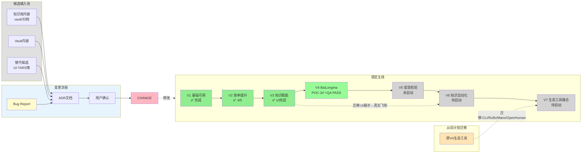

# Hermes Pro — 锁定版路线图（2026-05-28 重基线）

> 版本：Locked Roadmap v1.0
> 生效日期：2026-05-28
> 锁定规则：禁止 Agent 自行修改；变更需新建 ADR + 用户确认

---

## 路线图锁定声明

本文档是 Hermes Pro 的**唯一锁定计划**（Locked Roadmap）。

- **知识库内容不自动改变路线图**。vault/Desktop知识/归档文档只能进入候选池（Candidate Pool），需 ADR + 用户确认才能进入锁定主线。
- **禁止 Agent 自行修改路线图**。任何路线图变更必须新建 ADR，并等待用户确认。
- **已完成的版本不得回滚**。除非用户明确说"解锁路线图"。

---

## 整体计划架构

**图例说明**：
- 知识库内容（KB/VAULT）不能直接进入锁定主线，必须经过 ADR + 用户确认。
- 替代候选（ALTS）同样需经过此流程。
- Bug Report 只能通过 ADR + 用户确认修改 Locked Roadmap，不能直接进入 V6/V7。
- 锁定主线（LOCKED）只能通过 ADR + 用户批准后修改。

---

## V1-V7 总览表

| 版本 | 口号 | 状态 | 核心产出 |
|------|------|------|---------|
| **V1** | 基础可用 | ✅ 完成 | GBrain修复 + 启动修复 + PlaybookRunner + U-A/llm-checker |
| **V1.5** | 修复阶段 | ✅ 完成 | IPC审计 + any清理 + execSync→spawn + i18n四语言 |
| **V2** | 效率提升 | ✅ 4/5 完成 | Theme + AgentMonitor + MCP + Memory；BaiLongma移出 |
| **V3** | 知识赋能 | ✅ UI完成 | Knowledge页面 + Vault增强 + Recharts + GBrain stats + Horizon tab |
| **V4** | BaiLongma认知编排 | 🔄 POC-2✅+QA PASS | Layer 1-3 + POC-1 + POC-2 + typecheck通过 + Manual QA PASS；Productionization NOT APPROVED |
| **V5** | 变现检验 | ⏳ 未启动 | AI漫剧 + 语音Dograh |
| **V6** | 知识自动化补完 | ⏳ 待启动 | 承接V3未完成自动化任务 |
| **V7** | 生态工具融合 | ⏳ 待启动 | 承接原V4生态工具任务 |

---

## V3 未完成 → V6 映射表

原 V3 计划中**UI已完成，自动化未完成**的内容：

| 原任务 | 当前状态 | 迁移到V6 | 原因 |
|--------|---------|---------|------|
| GBrain typed links + dream cycle | ❌ 未实现 | V6 | 需额外设计，未进入V3实施 |
| Horizon cron 自动入vault + 评分阈值 | ❌ 未实现 | V6 | 桌面端只有read-only tab，无自动化 |
| K3 学习方向每周自动更新 | ❌ 未实现 | V6 | cron存在但K3任务未完成自动化闭环 |
| SQLite/Filesystem/Git MCP 配齐 | ⏳ 部分完成 | V6 | MCP UI已有，但Filesystem/Git MCP未配齐 |
| HCC流程入主线 | ❌ 未完成 | V6 | 阶段1-4未在代码中定义 |
| CodeGraph / codebase-memory-mcp 重新索引 | ❌ 未验证 | V6 | 存档文档称177文件/1222节点，实际nodes/edges=0 |

详见 [v6-knowledge-automation-plan.md](./v6-knowledge-automation-plan.md)

---

## 原V4未完成 → V7 映射表

| 原任务 | 当前状态 | 迁移到V7 | 原因 |
|--------|---------|---------|------|
| CLI-Anything | ❌ 未集成 | V7 | Python 3.14 TLS阻塞cli-hub安装 |
| Ruflo loop-workers | ❌ 未接入 | V7 | Hermes cron问题在业务层，非调度层 |
| Mano-P | ⏸️ 候选暂缓 | V7 | 候选暂缓：当前M5 16GB不满足Mano-P本地部署内存要求（需M4+ 32GB） |
| OpenHuman Memory Tree | ❏ 未启动 | V7 | 从未进入实施 |
| 每日知识摘要自动推送 | ❌ 未实现 | V7 | WeChat delivery受rate limit阻塞 |

**GUI-VLA 方向备注**：Mano-P 暂缓，UI-TARS Desktop 进入候选池，需单独试点验证后才能进入锁定路线图。

详见 [v7-ecosystem-integration-plan.md](./v7-ecosystem-integration-plan.md)

---

## 变更规则

1. **不允许 Agent 自行改路线图**。Agent 发现需变更时，必须新建 ADR 说明原因和建议。
2. **不允许知识库内容自动改路线图**。vault/归档/替代候选只能进入候选池，不能直接写入锁定主线。
3. **任何路线图变更必须新建 ADR**，并等待用户确认后才能修改本文档。
4. **已锁定版本不降级**。已完成的任务标记为完成，不得回滚。
5. **解锁条件**：用户明确说"解锁路线图"后，方可修改本文档。
6. **Roadmap Bug Report 通道**：如果 Agent 发现路线图存在链接错误、事实错误、状态冲突或会误导执行的问题，允许向用户提交 Roadmap Bug Report。报告只能包含问题、证据、建议修正，不得直接修改锁定路线图。用户确认后，按 ADR + 用户确认流程修改。

---

## 当前唯一下一步

> **P0：BaiLongma Manual QA ✅ 已完成（2026-05-29）**
>
> **P1：路线图锁定确认 ✅ 已完成**
>
> **P2：V6 知识自动化任务排序（进行中）**

---

## 相关文档

| 文档 | 用途 |
|------|------|
| [NEXT_STEP.md](../NEXT_STEP.md) | 下一步行动指南 |
| [CONTEXT.md](../CONTEXT.md) | 项目上下文 |
| [v2-status.md](./v2-status.md) | V2 各任务实际状态 |
| [v3-status.md](./v3-status.md) | V3 各任务实际状态 |
| [v6-knowledge-automation-plan.md](./v6-knowledge-automation-plan.md) | V6 知识自动化计划 |
| [v7-ecosystem-integration-plan.md](./v7-ecosystem-integration-plan.md) | V7 生态工具计划 |
| [deprecation-candidates-2026-05-28.md](./deprecation-candidates-2026-05-28.md) | 废弃/过时候选清单 |
| [bailongma/README.md](./bailongma/README.md) | BaiLongma 设计索引 |

---

*本文档是锁定版路线图。任何修改必须通过 ADR + 用户确认。*