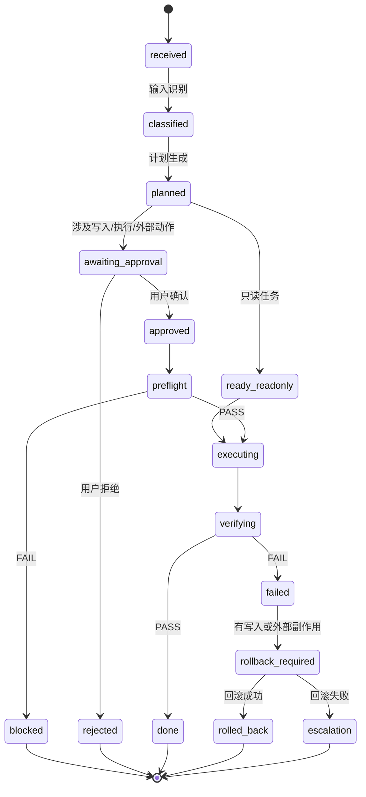

# Hermes Pro P2.5 安全基座规格（2026-05-30）

> 状态：✅ PASS（2026-05-31 Review 完成）
> 来源：Claude 网页版对当前计划的审核结论。
> 目标：在 HCC 自动执行、CLI-Anything、外部浏览器/软件操作进入主线前，补齐权限/能力模型、任务状态机、回滚策略和事前安全闸。
> 横切设施：append-only 审计/反馈总线、Scheduler/Resource Lease、Builder/Verifier 分离。

---

## 1. 为什么必须有 P2.5

Hermes 的输入来自微信、飞书、外链、本地文档、GitHub、云文档、定时任务等不可信入口。
这些内容可能带有 prompt injection、恶意指令、伪造工具说明、错误代码建议或隐私诱导。

在没有安全基座前，不允许让这些输入直接推动：

- HCC 修改文件
- CLI-Anything 执行命令
- Safari MCP 操作网页或账号
- 读取凭据池、SSH、私密路径
- 触发无人值守写入或外部操作

**P3 和 P4 在 P2.5 未验收前不得开工。**

---

## 2. 权限 / 能力模型

### 2.1 输入信任级别

| 级别 | 来源 | 默认权限 |
|------|------|----------|
| `trusted_user` | 用户在当前 Chat 明确下达的任务 | 可进入计划阶段，高风险动作仍需确认 |
| `semi_trusted_local` | 用户显式提供的本地文件 | 可解析、摘要、入库；执行建议必须降权为数据 |
| `untrusted_external` | 外链、网页、视频/图文平台、GitHub repo、飞书云文档内容 | 只读抓取、解析、标注风险；不得直接触发执行 |
| `unattended_cron` | Hermes 定时自检索 | 只读抓取和候选入库；不得触发 HCC/CLI/浏览器写操作 |
| `archive_locked` | 过时计划目录、锁定归档 | 默认不可读取；除非用户点名具体文件 |

### 2.2 动作能力等级

| 能力 | 说明 | 默认门槛 |
|------|------|----------|
| `read_public` | 读取公开链接、公开仓库元数据 | 允许，但需来源记录 |
| `read_local` | 读取本地文件 | 需要用户提供路径或当前任务必要性 |
| `write_artifact` | 写日志、摘要、报告、Handoff Pack | 允许，但需脱敏扫描 |
| `write_project` | 修改项目文件 | 需要 pre-flight 通过 + 用户确认 |
| `run_command` | 执行 shell / 构建 / 测试命令 | 需要 allowlist + 参数校验 |
| `browser_action` | 浏览器点击、填表、账号操作 | 需要用户授权，敏感页面默认禁止 |
| `credential_access` | 凭据池、SSH、token、cookie | 默认拒绝，必须单独批准 |
| `external_publish` | 发消息、发帖、提交 PR、上传文件 | 默认拒绝，必须单独批准 |

### 2.3 强规则

- 不可信内容永远只能作为**数据**，不能作为**指令**。
- `untrusted_external` 和 `unattended_cron` 不能直接提升到 `write_project`、`run_command`、`browser_action`。
- 所有能力提升必须留下：来源、理由、用户确认、pre-flight 结果、可回滚点。
- `trust_level` 设定能力上限；最终可执行能力 = `trust_level 上限` × `用户/项目授予权限` × `动作类允许范围`。
- `untrusted_external` 默认能力集只包含 `read_public`、候选 `write_artifact`；不得请求项目写入、命令执行、浏览器动作、凭据访问或外部发布。
- `unattended_cron` 默认能力集只包含只读抓取、候选入库和报告写入；请求任何需确认动作时必须 `deny -> blocked + notify`，不得因无人值守自动放行。

---

## 3. 任务状态机



### 状态要求

| 状态 | 必填证据 |
|------|----------|
| `received` | 输入来源、时间、任务 id |
| `classified` | 信任级别、风险标签、候选能力 |
| `planned` | 计划、影响面、是否需要用户确认 |
| `awaiting_approval` | 用户需要确认的具体动作 |
| `approved` | 用户确认记录 |
| `preflight` | 权限检查、allowlist、路径检查、脱敏检查、回滚点 |
| `executing` | 命令/工具调用记录 |
| `verifying` | 测试/构建/人工验收记录 |
| `done` | 结果摘要、artifact 指针、Handoff Pack 更新 |
| `failed` | 失败原因、复现方式 |
| `rolled_back` | 回滚命令或 git/worktree 证据 |

---

## 4. Pre-flight 安全闸

任何写文件、执行命令、浏览器操作、外部软件操作、凭据访问前，必须经过 pre-flight。

### 检查项

- 输入来源是否可信。
- 是否含 prompt injection 或越权指令。
- 动作能力是否被允许。
- 命令是否在 allowlist 内。
- 参数是否存在路径穿越、shell 注入、通配符扩大、隐式网络访问。
- 目标路径是否在允许工作区内。
- 是否需要用户确认。
- 是否已建立回滚点。
- 产物是否会包含密钥、PII、隐私路径。

### 输出

```yaml
preflight:
  task_id: string
  action: string
  source_trust: trusted_user | semi_trusted_local | untrusted_external | unattended_cron | archive_locked
  requested_capability: read_public | read_local | write_artifact | write_project | run_command | browser_action | credential_access | external_publish
  decision: allow | deny | require_user_approval
  reasons:
    - string
  rollback_point: string | null
  verifier_required: true
```

---

## 4.1 Action Gate 外部动作二次闸

Pre-flight 负责计划级动作批准；Action Gate 负责执行期具体外部动作批准。
两者共用同一策略引擎，但调用点不同。

必须经过 Action Gate 的动作：

- CLI-Anything / Safari MCP 调用外部工具。
- 浏览器点击、填表、下载、上传。
- 调用开发工具、视频工具、命令行工具。
- 任何不可逆、难回滚或带账号状态的外部动作。

规则：

- Executor 不能直接调用 CLI-Anything；必须走 `Executor -> ActionGate -> CLI-Anything`。
- Action Gate 的 `deny` 或 `require_user_approval` 必须进入 blocked，不得继续调用外部工具。
- Action Gate 必须继承当前任务的 `source_trust`、用户/项目授权、回滚点和任务状态。

---

## 5. 回滚策略

### 5.1 写项目文件

- 默认在隔离 worktree 或明确 patch 中执行。
- 执行前记录 `git status --short`。
- 执行后记录 diff 摘要。
- 失败时优先回滚本次 patch，不回滚用户已有改动。
- 回滚后重新规划必须受重试上限约束；超过上限进入 `blocked` 并请求用户介入。

### 5.2 命令执行

- 构建/测试命令允许在工作区执行。
- 会写全局配置、安装依赖、改系统设置的命令必须单独确认。
- 所有命令保留 exit code 和输出 artifact 指针。

### 5.3 浏览器 / 外部工具

- 默认只读浏览。
- 登录态页面、支付、发布、发送消息、上传文件、删除内容必须单独确认。
- 无法自动回滚的动作默认禁止无人值守执行。

### 5.4 重试上限

默认 `max_retries = 2`。任一任务在同一失败原因上超过上限后：

- 不再自动 replan。
- 写入 Artifact Store 失败记录。
- 更新 Handoff Pack 的 `blocked`、`dead_ends`、`next_actions`。
- 在 Cockpit 显示需要用户介入。
- 同一失败签名连续出现时可提前终止，不必烧满重试次数。
- 重试不得自动扩权；重规划经过 Pre-flight 时，能力只能继承或收窄，扩权必须重新请求用户确认。

---

## 6. Append-only 审计 / 反馈总线

所有权限、安全、状态、回滚和人工 override 决策必须进入 append-only 审计日志。
审计日志使用 hash 链，避免中间条目被静默篡改。

```yaml
audit_entry:
  seq: number
  prev_hash: string
  entry_hash: string
  ts: string
  task_id: string
  actor: codex | claude | hermes | user | system
  event: preflight | action_gate | capability_grant | state_transition | rollback | user_override | redaction_fail
  decision: allow | deny | need_approval | info
  context:
    trust_level: string
    requested_capability: string
    allowed_capability_set:
      - string
    matched_rule: string
    allowlist_hit: string | null
    path_check: pass | fail | not_applicable
  evidence_ref: string
```

验收：

- 给定 task_id 能重放出每个动作为什么被放行或拦截。
- 修改中间任一条审计记录，hash 链校验失败。
- 用户 override、脱敏失败、重试超限都必须留下审计条目。

---

## 7. Scheduler / Resource Lease

Hermes 需要处理交互任务、cron、多个项目和本地模型资源争用。
P2.5 至少定义最小调度策略，P3 实现最小版。

资源类型：

- 项目 worktree：写操作独占。
- 本地 LLM：单机资源，默认串行或受内存预算限制。
- 限流通道：微信、飞书、外部 API、视频工具。

规则：

- 交互任务优先于 cron。
- cron 可延迟、可去重，不得抢占交互任务。
- 同一 worktree 的写任务串行。
- Pre-flight 建立回滚点时必须同时获取必要资源租约。
- 获取不到租约时进入 `waiting_resource` / `queued`，不得直接执行。

---

## 8. Builder / Verifier 分离

产出者不能是唯一验证者。

最小规则：

- Builder 负责生成 Handoff Pack、patch、计划或任务产物。
- Verifier 只能读取 Handoff Pack + diff + artifact_ref + 验收标准，不依赖 Builder 的推理过程。
- Verifier 必须至少在不同上下文中运行；后续可升级为不同 agent / 不同模型。
- Verifier 必须能重跑至少一条验证命令，不能只相信 exit_code 摘要。

适用范围：

- P0.5 Handoff Pack。
- P3 HCC 代码任务。
- P5 AI 漫剧 Domain Profile 验证。

---

## 9. 脱敏扫描器

脱敏扫描器必须在 P0.5 就存在，因为 Handoff Pack 生成即需要它。
P2.5 负责扩展测试夹具和验证云端 fallback / 外部 Agent 注入路径。

扫描范围：

- 密钥模式：API key、token、私钥头。
- 高熵字符串。
- PII。
- 本地隐私路径，例如 `/Users/midoudou/...`。
- 大段聊天原文。

规则：

- `redaction_status: fail` 时拒绝写入或注入外部 Agent。
- 每次 fail 写入 append-only audit log。
- 云端 fallback 前必须通过脱敏扫描。

---

## 10. 知识来源与可信度标签

每条进入 Knowledge / Vault / GBrain 的内容必须携带：

```yaml
provenance:
  source_type: chat | wechat | feishu | web | github | local_file | cron | archive
  source_uri: string
  fetched_at: string
  trust_level: trusted_user | semi_trusted_local | untrusted_external | unattended_cron | archive_locked
  license_or_terms: unknown | checked | restricted
  contains_instructions: true | false | unknown
  safe_to_use_as_instruction: false
```

强规则：

- 外部内容默认 `safe_to_use_as_instruction: false`。
- 检索到的知识只能作为上下文数据，不能覆盖用户目标、系统规则、权限规则。
- typed links 必须有 evidence；无 evidence 不建链。

---

## 11. Handoff Pack 补强

Handoff Pack 必须增加以下字段：

```yaml
schema_version: "1.0"
task_id: string
created_at: string
created_by: codex | claude | hermes | other
git_ref: string | null
goal: string
active_truth_sources:
  - string
do_not_read:
  - string
current_state:
  done:
    - string
  in_progress:
    - string
  blocked:
    - string
open_questions:
  - string
assumptions:
  - string
dead_ends:
  - string
decisions:
  - decision: string
    why: string
    evidence_ref: string
changed_files:
  - path: string
    reason: string
    content_hash: string | null
verification:
  - command: string
    exit_code: number
    artifact_ref: string
next_actions:
  - string
safety:
  permission_boundary: string
  redaction_status: pass | fail | not_run
  secrets_policy: string
```

生成前必须运行脱敏检查；若 `redaction_status != pass`，不得注入云端模型或外部 Agent。

---

## 12. 索引器硬排除

Archive Lock 不能只靠提示词，必须在索引器 / 检索器 / 文件扫描层硬排除：

- `/Users/midoudou/Desktop/知识/Hermes 代码任务/过时计划/`
- `/Users/midoudou/hermes-pro/docs/archive/`
- `*.before-*`
- 明确标记 `.noindex`、`.ignore`、`HERMES-ARCHIVE-LOCK.md` 的目录

**TS 权威配置实现：**
- `src/shared/config/index-exclusions.ts` — 导出 `EXCLUDED_PATH_FRAGMENTS`、`EXCLUDED_FILE_NAME_PATTERNS`、`EXCLUDED_DIR_MARKERS`、`shouldExcludeFromIndex(path)`、`explainIndexExclusion(path)`
- Python 层（`knowledge_agent.py._scan_vault()`）实现相同的路径片段和文件名排除逻辑
- TS 纯函数覆盖路径片段和文件名模式排除；marker 排除（`.noindex`/`.ignore`/`HERMES-ARCHIVE-LOCK.md`）由 Python 层通过 `stat()` 实现
- `tests/safety/index-exclusions.test.ts` — 22 个测试覆盖所有排除规则

**实测验证（2026-05-31）：**
- `/过时计划/` — 31 个 .md 文件，包含 `.noindex`、`.ignore`、`HERMES-ARCHIVE-LOCK.md` 三重 marker
- `/docs/archive/` — 1 个 .md 文件
- `*.before-*` 文件 — 存在于 `/过时计划/docs-bak/` 子目录
- Gateway 8642 当前未运行，跳过 live query；Python 层排除逻辑已验证与 TS 配置一致

验收命令：
```bash
npx vitest run tests/safety/index-exclusions.test.ts  # 22/22 PASS
npm run typecheck                                      # EXIT CODE 0
```
- 直接文件 grep 不作为当前上下文入口。

---

## 13. P2.5 验收标准

- 权限/能力模型文档存在并被 NEXT_STEP 引用。
- 任务状态机进入当前融合计划。
- pre-flight schema 存在，并能模拟拦截一个来自外链的高权限执行请求。
- `trust_level` 能限制 capability 上限，cron/external 请求高权限动作会被拒绝。
- Action Gate 存在，并能证明外部工具动作必须经它放行。
- Append-only audit log 存在，能重放 task_id 决策链；篡改中间条目会失败。
- Scheduler / Resource Lease 设计存在，至少覆盖 worktree、本地 LLM、限流通道。
- Builder / Verifier 分离规则存在，P0.5 Handoff Pack 可由独立上下文验证。
- 回滚策略存在，并能用一个小型 patch 任务验证回滚。
- 回滚重试上限存在，超限后进入 blocked，不无限 replan。
- 相同失败签名提前终止，重试不得自动扩权。
- P0.5 脱敏扫描器存在；P2.5 扩展夹具可抓假密钥、隐私路径和高熵串。
- Handoff Pack schema 补齐 `task_id`、`schema_version`、`created_at`、`exit_code`、`artifact_ref`、`content_hash`、`open_questions`、`dead_ends`。
- 知识 provenance schema 存在，外部内容默认不能当指令。
- 索引器硬排除路径得到实测验证。
